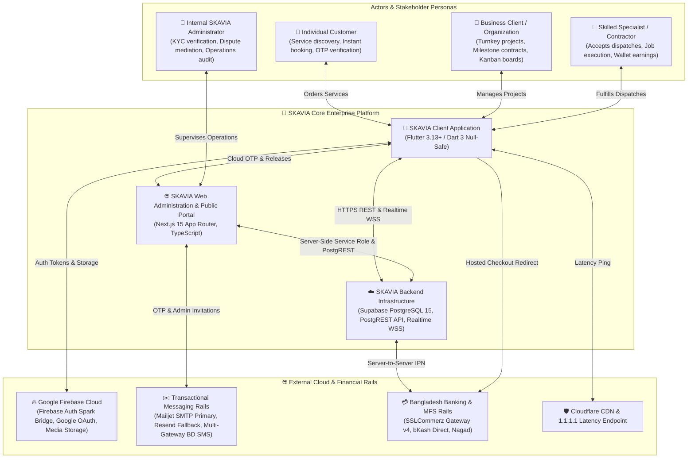

# SKAVIA — On-Demand Services & Skilled Workforce Platform

<p align="center">
  
</p>

<p align="center">
  <strong>Accountable On-Demand Services, Skilled Workforce Management & Escrow Financial Settlement</strong><br>
  <em>An independently developed enterprise ecosystem for doorstep technical maintenance, commercial turnkey contracting, and verified workforce dispatch.</em>
</p>

<p align="center">
  
  
  
  
  
  
  
  
  
  
</p>

---

## 📌 Project Overview

**SKAVIA** is an accountable service and workforce management platform designed for the Bangladesh market. 

Unlike unmonitored classified directories, SKAVIA provides an end-to-end operational guarantee:
1. **Physical Arrival Verification:** Cryptographic 4-digit arrival OTP handoff required before any billable timer or job execution begins.
2. **Atomic Escrow Financial Settlement:** Customer funds are held securely in escrow upon order confirmation and released to the worker's earnings wallet only after customer digital sign-off.
3. **Multi-Role Single Enterprise Ecosystem:** One unified mobile application serving Individual Customers, Enterprise Business Clients, and Skilled Specialists (Workers), supervised by an administrative web console (`admin-web`).
4. **Device Detection & Smart APK Recommendation:** Real-time client-side device telemetry that automatically highlights the optimal 5G/4G 64-bit APK (`arm64-v8a`) or 32-bit legacy APK (`armeabi-v7a`), with dedicated iOS Web App (PWA) guidance.
5. **On-Device Hardware & Network Diagnostics:** Built-in mobile diagnostics module inspecting device hardware, permissions, and network edge latency with strict privacy controls (zero IMEI, zero serials, zero GPS logging).

---

## 🏛️ System Architecture



For complete architectural specifications, see the [Architecture Documentation](docs/architecture/system-overview.md) and [Editable Mermaid Diagrams](docs/diagrams/).

---

## 📂 Source Code Directory Structure

```
SKAVIA/
├── lib/                               # Flutter Mobile Client Source
│   ├── main.dart                      # Minimal application bootstrap
│   ├── app/                           # App configuration, routing & themes
│   ├── core/                          # Cross-cutting foundational services
│   ├── shared/                        # Reusable design system & UI components
│   └── features/                      # Modular feature-first business domains
│       ├── authentication/            # Login, registration, OTP & role selection
│       ├── billing/                   # Invoices, escrow status & payment handoff
│       ├── customer/                  # Category catalog, bidding & bookings
│       ├── diagnostics/               # On-device hardware, permissions & latency
│       ├── navigation/                # Main shell scaffold & role mode switcher
│       ├── notifications/             # Notification center & urgent alert routing
│       ├── profile/                   # User profile, security & settings
│       ├── team_project/              # Turnkey commercial projects & Kanban
│       ├── update/                    # Android in-app update & SHA-256 verify
│       └── worker/                    # Dispatch radar, job timers & active jobs
│
├── admin-web/                         # Next.js 15 Web Portal & Admin Console
│   ├── src/app/                       # App Router pages & API routes
│   ├── src/features/                  # Public website, passkey auth & admin panels
│   └── public/downloads/              # Official production APK binaries
│
├── supabase/                          # PostgreSQL 15 Database Tier
│   └── migrations/                    # 8 Sequential SQL migrations (58 tables total)
│
├── test/                              # Comprehensive Flutter Test Suite (182 tests)
│   └── unit/                          # Unit & widget tests verifying 320dp layouts & logic
│
└── docs/                              # Comprehensive Documentation Hub
```

---

## ⚡ Quick Start & Development

### 1. Flutter Mobile App
```powershell
# Install Flutter dependencies
flutter pub get

# Run static analysis (strict zero-warning policy)
dart analyze --fatal-infos

# Run comprehensive test suite (182 unit/widget tests)
flutter test

# Run application on Android or Desktop
flutter run
```

### 2. Admin Web Portal
```powershell
cd admin-web

# Install npm dependencies
npm ci

# Run lint, typecheck and test suite (43 vitest tests)
npm run lint
npm run typecheck
npm test

# Build production bundle
npm run build

# Start development server
npm run dev
```

For detailed setup instructions and environment variable configurations, refer to the [Getting Started Guide](docs/development/getting-started.md).

---

## 📚 Complete Documentation Index

| Topic | Documentation Link |
| :--- | :--- |
| **System Overview & C4 Model** | [docs/architecture/system-overview.md](docs/architecture/system-overview.md) |
| **Web Ecosystem Architecture (Public Site & Admin Portal)** | [docs/architecture/web-ecosystem-architecture.md](docs/architecture/web-ecosystem-architecture.md) |
| **Flutter Application Architecture** | [docs/architecture/application-architecture.md](docs/architecture/application-architecture.md) |
| **Feature Directory Decomposition** | [docs/architecture/feature-architecture.md](docs/architecture/feature-architecture.md) |
| **Authentication & Identity Flow** | [docs/architecture/authentication-flow.md](docs/architecture/authentication-flow.md) |
| **Authorization & User Roles** | [docs/architecture/authorization-and-roles.md](docs/architecture/authorization-and-roles.md) |
| **Data Flow & Escrow Lifecycle** | [docs/architecture/data-flow.md](docs/architecture/data-flow.md) |
| **Multi-Cloud Infrastructure** | [docs/architecture/infrastructure.md](docs/architecture/infrastructure.md) |
| **System Diagrams (Mermaid)** | [docs/diagrams/](docs/diagrams/) |
| **Developer Getting Started** | [docs/development/getting-started.md](docs/development/getting-started.md) |
| **Project Structure Guide** | [docs/development/project-structure.md](docs/development/project-structure.md) |
| **Coding & Responsive Guidelines** | [docs/development/coding-guidelines.md](docs/development/coding-guidelines.md) |
| **Dependency Rationale Audit** | [docs/development/dependencies.md](docs/development/dependencies.md) |
| **Developer Troubleshooting** | [docs/development/troubleshooting.md](docs/development/troubleshooting.md) |
| **PostgreSQL Database Schema** | [docs/backend/database-schema.md](docs/backend/database-schema.md) |
| **Supabase Stored Procedures (RPC)** | [docs/backend/supabase-integration.md](docs/backend/supabase-integration.md) |
| **Row-Level Security (RLS)** | [docs/backend/rls-security.md](docs/backend/rls-security.md) |
| **Storage Bucket Policies** | [docs/backend/storage.md](docs/backend/storage.md) |
| **API Reference Catalog** | [docs/backend/api-reference.md](docs/backend/api-reference.md) |
| **Android Release & Keystore Signing** | [docs/deployment/android-release.md](docs/deployment/android-release.md) |
| **Production Pre-Flight Checklist** | [docs/deployment/production-checklist.md](docs/deployment/production-checklist.md) |
| **Project Status & Test Metrics** | [docs/project/project-status.md](docs/project/project-status.md) |
| **Third-Party Open-Source Licenses** | [docs/project/third-party-licenses.md](docs/project/third-party-licenses.md) |

---

## 🔒 Ownership, Author & License

- **Product:** SKAVIA
- **Product Type:** Service and Workforce Management Platform
- **Developer / Author:** **Timon Biswas** ([GitHub: @Ti838](https://github.com/Ti838))
- **Organization:** Independent Project
- **Copyright:** &copy; 2026 Timon Biswas. All rights reserved.
- **License:** Proprietary Software License — All Rights Reserved. See [LICENSE](LICENSE) for terms.
- **Third-Party Open-Source Attributions:** See [Third-Party License Inventory](docs/project/third-party-licenses.md).
