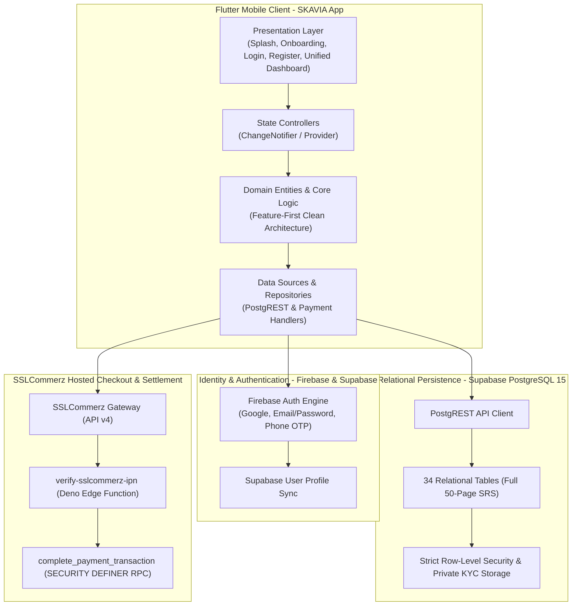

<p align="center">
  
</p>

<h1 align="center">SKAVIA</h1>
<p align="center">
  <strong>Solution-Oriented Service & Workforce Platform</strong><br>
  <em>Enterprise On-Demand Service & Skilled Workforce Ecosystem</em>
</p>

<p align="center">
  
  
  
  
  
  
  
</p>

---

## 📌 Platform Overview & Engineering State

* **System:** SKAVIA Solution-Oriented Service & Workforce Platform
* **Target Platforms:** Android / iOS / Web (Flutter 3.x)
* **Engineering Paradigm:** Feature-First Domain-Driven Clean Architecture
* **Security Standard:** Row Level Security (RLS) on all relational tables, private KYC storage isolation, and zero-PII marketplace views.
* **Payment Standard:** Server-authoritative SSLCommerz hosted checkout, bank IPN validation edge function, and atomic, idempotent settlement.

---

## 🏗️ System Architecture & Integration Flow



---

## 🚀 Key Completed Milestones

### 1. Core UI & Onboarding
- **Splash & Onboarding:** Smooth initial splash and animated onboarding carousel.
- **Authentication:** Email & password authentication, login, registration, and phone OTP verification interfaces.
- **Unified Main Dashboard:** Dual-mode navigation hub dynamically switching between Customer view and Worker view.

### 2. Database Hardening & Security Remediation
- **User Privacy (RLS):** Strict Owner-Only Row Level Security on `public.users` (`auth.uid()::text = user_id`) with anonymous access completely revoked.
- **Zero-PII Marketplace Directory:** `marketplace_public_profiles` view exposing only approved public worker metrics while strictly excluding phone numbers, emails, and credentials.
- **Private KYC Storage:** `verifications` bucket access restricted strictly to file owners (`(storage.foldername(name))[1] = auth.uid()::text`).

### 3. Server-Authoritative SSLCommerz Payment Integration
- **Hosted Checkout:** SSLCommerz API v4 session initialization with bound payment correlation references (`value_a: paymentId`).
- **Edge Function Verification:** Server-to-server bank validation (`verify-sslcommerz-ipn`) against official SSLCommerz transaction validation APIs, rejecting counterfeit callbacks and mismatched amounts.
- **Atomic & Idempotent Settlement:** `complete_payment_transaction` RPC executing under `service_role` with row-locking (`FOR UPDATE`) and unique constraints preventing duplicate transactions, invoices, or earnings.
- **Debounce & Polling UX:** Eliminated client-side fallbacks; checkout debounced against repeated taps and status authoritatively polled with bounded backoff.

### 4. Comprehensive Automated Test Suite
- **37 Automated Tests Passing (100% Pass Rate):**
  - **15 Security & Settlement Tests:** Currency checking, amount matching, non-VALID status rejection, idempotency, debouncing, and private-data protection.
  - **8 Billing & Fee Model Tests:** Mathematical fee split isolation (85% worker / 15% SKAVIA fee).
  - **14 Taxonomy, Matching & Feature Tests:** Category taxonomy, weighted matching engine, chat models, and smoke tests.
- **Static Analysis:** `flutter analyze` passing with 0 warnings and 0 errors.

---

## ⚡ Quick Verification Commands

```bash
# Code formatting check
dart format --output=none --set-exit-if-changed lib test

# Run static codebase analysis
flutter analyze

# Execute full test suite (37 tests)
flutter test
```

---

## 📄 License

This project is licensed under the MIT License - see the [LICENSE](LICENSE) file for details.

---

<p align="center">
  <em>SKAVIA Platform • Production-Ready Flutter Architecture & Dual Cloud Ecosystem</em>
</p>
