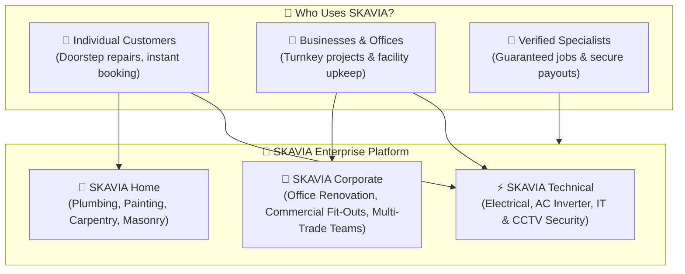
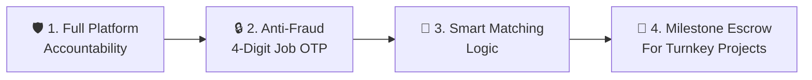
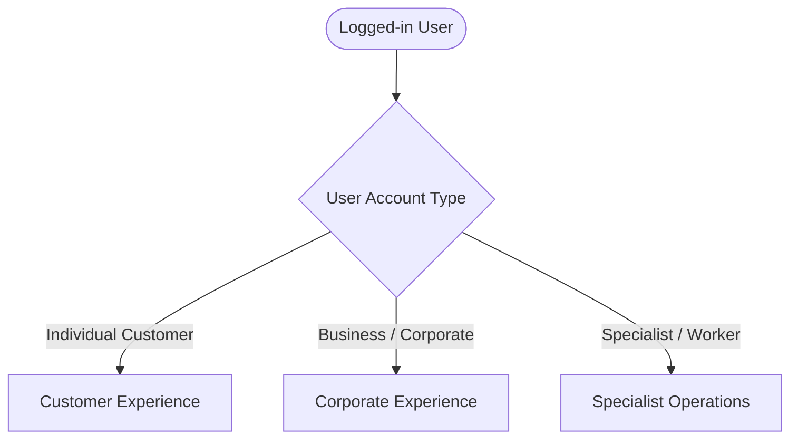
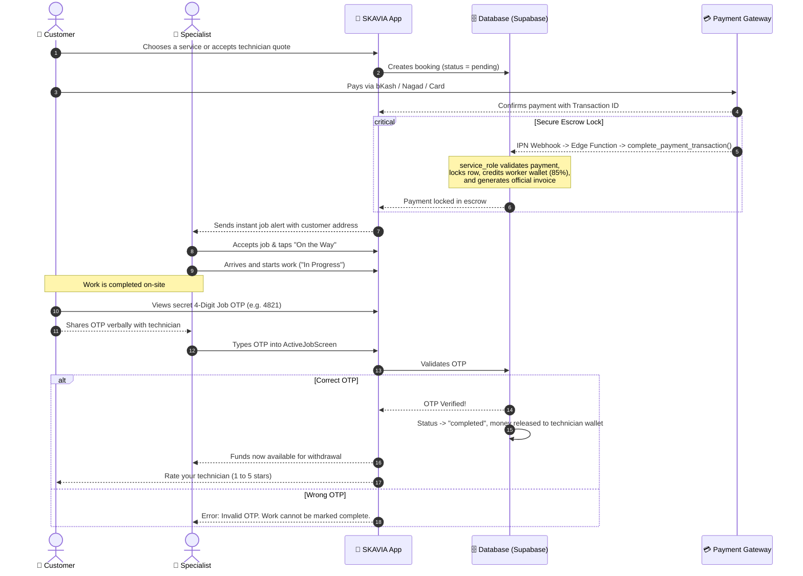

# SKAVIA — On-Demand Services & Skilled Workforce Platform

<p align="center">
  
</p>

<p align="center">
  <strong>Every Skill. Every Opportunity.</strong><br>
  <em>A unified platform for on-demand home repairs, technical services, commercial turnkey projects, and secure escrow payments.</em>
</p>

<p align="center">
  
  
  
  
  
  
  
  
</p>

---

## 📖 1. What is SKAVIA?

**SKAVIA** is an all-in-one platform built for on-demand home services, technical maintenance, and commercial turnkey projects. 

Instead of acting like an unverified open classifieds board where anyone can post an ad, **SKAVIA operates as a trusted, verified service platform**. When a customer books a service, SKAVIA assigns vetted specialists, tracks the work in real time, holds payments safely in escrow, and only releases payment when the customer is completely satisfied.

### The Three Service Branches of SKAVIA:



1. **SKAVIA Technical (`TECH`):** Electrical repairs, inverter AC servicing, industrial wiring, CCTV installation, and network setup.
2. **SKAVIA Home (`HOME`):** Sanitary plumbing, leak repairs, wall painting, waterproofing, and custom wood carpentry.
3. **SKAVIA Corporate (`CORP`):** Full office renovations, commercial fit-outs, and multi-specialist project teams.

> Beyond the core three (`TECH`, `HOME`, `CORP`), migration [`20261112000000`](supabase/migrations/20261112000000_admin_invitations_passkeys_and_superadmin.sql) seeds 6 additional internal specialization branches (`AGRI`, `LOGI`, `DIGI`, `BIZ`, `CONS`, `EVNT`), totaling **9 database branches** (**8 consumer-facing branches** displayed on the public website).

---

## 🎯 2. The Problems We Solve

In traditional service markets, hiring a technician is often stressful, risky, and unreliable. SKAVIA solves these everyday problems directly:

| Traditional Problem | Real-World Issue | How SKAVIA Solves It |
| :--- | :--- | :--- |
| **Safety & Trust Concerns** | Strangers enter homes without background checks or verified identity. | **100% Verified Specialists:** Every technician must pass National ID (NID) checks, police verification, and a practical skill test. |
| **Unpredictable Pricing** | Technicians quote arbitrary prices after arriving, leading to arguments. | **Fixed, Upfront Pricing:** Standard catalog services have clear, fixed rates in BDT. No hidden fees. |
| **Unfinished Work** | Contractors demand payment before the work is properly finished. | **4-Digit Handshake OTP:** Technicians cannot mark a job complete without the customer's secret 4-digit code. |
| **Commercial Contract Risks** | Businesses lose money when contractors delay or abandon large projects. | **Milestone Escrow:** Project funds are held securely and released stage by stage only after inspection. |
| **No Arrival Time Tracking** | Customers wait hours without knowing when the technician will arrive. | **Live Proximity Radar:** Customers can view nearby technicians on an animated radar screen. |
| **No Digital Receipts** | Cash payments leave no proof of transaction or tax records. | **Instant Digital Invoices:** Downloadable VAT-compliant receipts are generated automatically for bKash, Nagad, and card payments. |

---

## 🏛️ 3. The Four Core Pillars of SKAVIA



1. **Full Platform Accountability:** Every service request is backed by responsive customer support, quality standards, and customer protection.
2. **Anti-Fraud 4-Digit Handshake OTP:** When a technician finishes work, the customer gives them a secret 4-digit code shown on the customer's phone. Entering this code confirms completion and unlocks the payment.
3. **Smart Matching Logic:** When customers post custom requirements, the system automatically finds and ranks the best-suited specialists based on skills, distance, ratings, and budget.
4. **Milestone Escrow for Turnkey Projects:** Large projects are broken down into clear stages. Money is held safely in escrow and released one stage at a time as each milestone is approved.

---

## 🛠️ 4. Core Features & Smart Logic Used in SKAVIA

Rather than complex academic math, SKAVIA applies clean, real-world software engineering logic to solve everyday on-demand service problems:

### 1. Smart Candidate Matching Logic
* **What we used:** A practical 4-factor scoring check in `SpecialistMatchingEngine`.
* **How it works:** When a customer requests a job, available technicians are ranked by:
  - **Skill Match (40%):** Does the specialist have the exact skills required for this job?
  - **Proximity (25%):** How close is the technician to the customer's location (prioritizing technicians within 2 km)?
  - **Reputation (20%):** Customer ratings and past completed jobs on the platform.
  - **Budget Fit (15%):** Does the specialist's hourly rate match what the customer wants to pay?
* **Why it matters:** The customer instantly sees the top, most relevant specialists at the top of their screen.

---

### 2. Device-Based Distance Calculation
* **What we used:** Direct latitude and longitude distance calculation in `LocationService` and `RadarMapCanvas`.
* **How it works:** Compares the GPS coordinates of the customer and the technician to find the exact distance in kilometers.
* **Why it matters:** Runs directly on the user's phone in milliseconds without needing expensive paid third-party map API requests for simple distance checks.

---

### 3. Anti-Fraud 4-Digit Job OTP Verification
* **What we used:** Secure random 4-digit code verification between `JobOtpBannerCard` and `ActiveJobScreen`.
* **How it works:**
  1. When a booking starts, the system generates a random 4-digit code (e.g. `4821`) visible **only on the customer's phone**.
  2. When the technician completes the repair work on site, the customer tells the code to the technician.
  3. The technician inputs the code into the app.
  4. Once verified by the database, the job marks as completed and the technician receives payment.
* **Why it matters:** Technicians cannot falsely mark jobs completed to claim money without actually visiting the customer.

---

### 4. Safe Financial Settlement (Atomic Database Transaction)
* **What we used:** PostgreSQL stored procedure (`complete_payment_transaction`) inside an atomic database transaction.
* **How it works:**
  - **Duplicate Prevention:** Locks the transaction row so double taps or delayed network requests never process twice.
  - **Automatic Split:** Automatically allocates 85% of the payment to the technician's earnings wallet and 15% to the platform service account.
  - **All-or-Nothing:** Updates booking status, credits wallet balance, and creates an official digital receipt simultaneously. If any step fails, the entire transaction cancels safely.
* **Why it matters:** Guarantees zero lost money, zero duplicate deductions, and accurate bookkeeping.

---

### 5. Interactive Radar Visualizer
* **What we used:** Custom Flutter Canvas rendering in `RadarMapCanvas`.
* **How it works:** Takes GPS locations of nearby specialists and maps them onto a clean circular radar screen with an animated sweep effect.
* **Why it matters:** Customers can see nearby technicians in real time with a modern, responsive UI.

---

### 6. Offline-First Sync Queue
* **What we used:** Local SQLite/cache queuing in `OfflineSyncQueueService` with auto-retry.
* **How it works:** If a user saves an address or updates profile details while having no internet connection, the app saves the action safely on the device. As soon as the internet connection returns, it automatically uploads the changes to the database.
* **Why it matters:** The app never crashes or loses user inputs even in poor network conditions.

---

## 👥 5. User Roles and Experiences

SKAVIA automatically adapts its screens, menus, and permissions based on who logs in:



* 👤 **Individual Customers:** Browse service catalog, book doorstep repairs in 1 tap, describe custom jobs with AI assistance, track technicians on radar, chat in real time, and pay securely via bKash, Nagad, or cards.
* 🏢 **Business Clients:** Manage commercial turnkey renovations, create multi-specialist teams, manage milestone payments in escrow, track progress on Kanban task boards, and download VAT-compliant invoices.
* 🔧 **Specialists & Technicians:** Receive real-time job notifications, manage weekly working shifts, verify completed work using 4-digit OTPs, track earnings, and request bank or MFS withdrawals.

---

## 🏗️ 6. System Architecture

SKAVIA is built following **Clean Architecture** principles to keep code modular, testable, and maintainable:

```
┌────────────────────────────────────────────────────────┐
│               PRESENTATION LAYER (Flutter)             │
│   Screens, Custom Widgets, Theme Tokens, Navigation    │
└───────────────────────────┬────────────────────────────┘
                            │
┌───────────────────────────▼────────────────────────────┐
│               STATE CONTROLLER LAYER                   │
│   ChangeNotifier Controllers (Auth, Customer, Worker)  │
└───────────────────────────┬────────────────────────────┘
                            │
┌───────────────────────────▼────────────────────────────┐
│                    DOMAIN LAYER                        │
│   Business Entities, Value Objects, Repository Models  │
└───────────────────────────┬────────────────────────────┘
                            │
┌───────────────────────────▼────────────────────────────┐
│                    DATA LAYER                          │
│   Supabase PostgREST, WebSockets, Firebase, SSLCommerz │
└────────────────────────────────────────────────────────┘
```

* **Frontend:** Flutter 3.38+ with Dart 3.10+ (Null-Safe).
* **Database & Realtime:** Supabase PostgreSQL 15 across **58 tables** (`supabase_schema.sql` + **8 migrations**) with Row Level Security (RLS).
* **Authentication & Media:** Firebase Auth (SMS OTP, Google, Email/Password) + Firebase Cloud Storage (mobile) and HMAC Session + WebAuthn/TOTP MFA (`admin-web`).
* **Payments:** SSLCommerz, bKash, and Nagad (verified server-side via `verify-sslcommerz-ipn` Edge Function).

---

## 🔄 7. How a Service Booking Works



---

## 📚 8. Core Documentation

| Document | Coverage |
| :--- | :--- |
| [`docs/ARCHITECTURE.md`](docs/ARCHITECTURE.md) | System C4 diagrams, Flutter Clean Architecture, Admin Portal boundaries |
| [`docs/DATABASE_SCHEMA.md`](docs/DATABASE_SCHEMA.md) | PostgreSQL schema, RLS policies, atomic settlement RPCs |
| [`docs/APP_RELEASE_AND_UPDATE_ARCHITECTURE.md`](docs/APP_RELEASE_AND_UPDATE_ARCHITECTURE.md) | Signed APK releases, SHA-256 verification, in-app update checker |
| [`docs/DEPLOYMENT_GUIDE.md`](docs/DEPLOYMENT_GUIDE.md) | Supabase migrations, Vercel (`admin-web/`) setup, Flutter release builds |

---

## 🚀 9. How to Run Both Applications

### A. Flutter Mobile Application (`lib/`, `test/`)
1. Copy `.env.example` to `.env` and populate your Supabase & gateway keys.
2. Run static analysis, tests, and app startup:
```powershell
flutter pub get
flutter analyze --no-fatal-infos
flutter test
flutter run
```

### B. Admin Web Portal & Public Website (`admin-web/`)
1. Copy `admin-web/.env.example` to `admin-web/.env.local` and configure Firebase public SDK keys plus server-only `SUPABASE_SERVICE_ROLE_KEY` and `ADMIN_SESSION_SECRET`.
2. Verify, test, build, and run:
```powershell
Set-Location admin-web
npm install
npm run typecheck
npm run lint
npm test
npm run build
npm run dev      # Starts on http://localhost:3001
```

See [`docs/DEPLOYMENT_GUIDE.md`](docs/DEPLOYMENT_GUIDE.md) for Vercel deployment, domain configuration, and Supabase migrations.

---

## 🛡️ 10. Quality & Verification Highlights

```text
========================================================================================
SKAVIA ECOSYSTEM ARCHITECTURE SUMMARY
========================================================================================
[1] Mobile Static Analysis & Tests  : flutter analyze --no-fatal-infos + flutter test (152 tests / 17 files)
[2] Admin Portal Verification       : tsc --noEmit, eslint (--max-warnings=0), vitest (20 tests), next build, Playwright (5 specs)
[3] Database & Security             : PostgreSQL RLS + 8 Migrations + Immutable Audit Logs + Maker-Checker
[4] Modularity                      : Feature-first Flutter (lib/features/*) & Admin Portal (admin-web/src/features/*)
[5] License                         : MIT License
========================================================================================
```

---

## 📄 11. License

This project is licensed under the **MIT License** — see the [LICENSE](LICENSE) file for details.

---

<p align="center">
  <strong>SKAVIA</strong><br>
  <em>Every Skill. Every Opportunity.</em><br>
  © 2026 Timon Biswas
</p>
