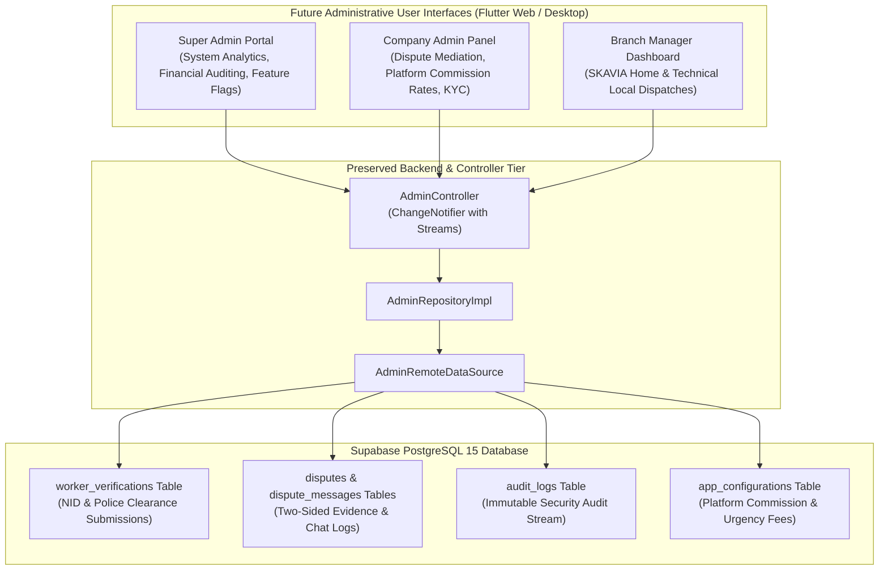
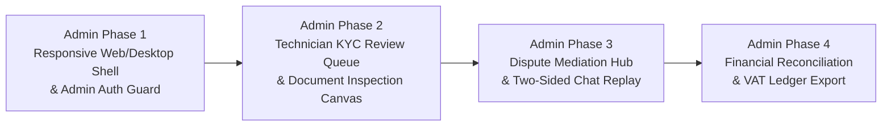

# SKAVIA — Admin Side Implementation Roadmap (Future Phase)

<p align="center">
  
</p>

<p align="center">
  <strong>Strategic Engineering Blueprint & Architecture Specification for Future Administrative Interfaces</strong><br>
  <em>Preserved Core Backend • Scheduled Multi-Role Governance • Phased Rollout Strategy</em>
</p>

---

## 📑 1. Scope Definition & Intentional Postponement

Per the Master Engineering Specification, the **Admin Side UI** has been intentionally postponed to follow the complete delivery of the user-facing platform.

### Preserved & Ready in Current Codebase:
- **Database Schema:** `branches`, `user_roles`, `worker_verifications`, `disputes`, `dispute_messages`, `audit_logs`, `app_configurations`.
- **Remote DataSources & Repositories:** [`AdminRemoteDataSource`](file:///c:/Users/TIMON/Desktop/SKAVIA/lib/features/admin/data/datasources/admin_remote_datasource.dart), `AdminRepository`, [`AdminController`](file:///c:/Users/TIMON/Desktop/SKAVIA/lib/features/admin/presentation/controllers/admin_controller.dart).
- **Stored Procedures & Row-Level Security:** Database roles and transactional RPCs governing administrative actions are fully preserved and tested.

### Scheduled for Future Administrative Phase:
1. **Super Admin Web/Desktop Portal:** Platform-wide analytics, financial reconciliation, feature flags, and system-wide audit logs.
2. **Company Admin Operational Panel:** High-level workforce management, commission fee rate management, and escalated dispute mediation.
3. **Branch Manager Dashboards:** Branch-specific operations (`SKAVIA Technical` vs. `SKAVIA Home`), technician KYC document verification queue, and localized dispatch monitoring.

---

## 🏛️ 2. Administrative Architecture Blueprint



---

## ⏱️ 3. Phased Implementation Timeline



---

## 🛠️ 4. Ready-to-Use Controller Capabilities

The future admin screens will connect directly to the existing [AdminController](file:///C:/Users/TIMON/Desktop/SKAVIA/lib/features/admin/presentation/controllers/admin_controller.dart):

1. **KYC Verification Stream:**
   ```dart
   final adminCtrl = AdminController();
   await adminCtrl.fetchVerificationQueue();
   // Renders pending worker NID cards, trade certificates, and approval actions
   await adminCtrl.approveWorkerKYC(workerProfileId);
   ```
2. **Dispute Resolution Pipeline:**
   ```dart
   await adminCtrl.fetchDisputes();
   // Renders customer claims, photos, and evidence messages
   await adminCtrl.resolveDispute(disputeId, resolutionDecision);
   ```
3. **Dynamic Operational Controls:**
   ```dart
   await adminCtrl.updatePlatformConfig('commission_rate', 0.15);
   ```
