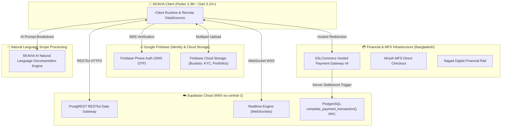
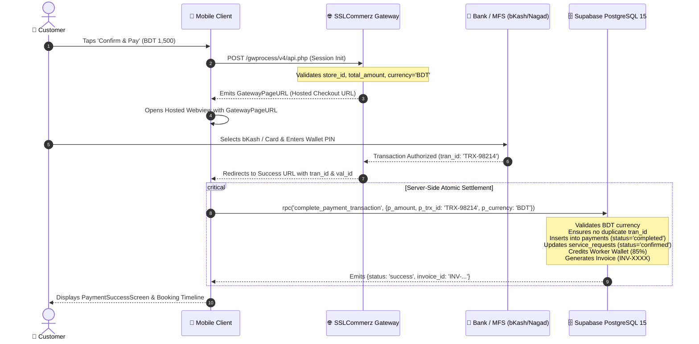
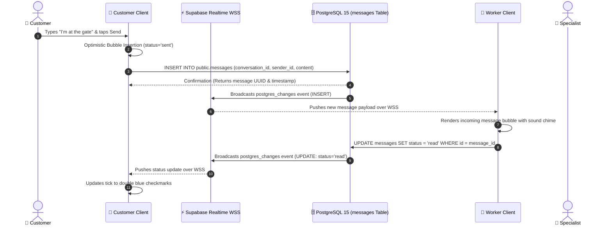
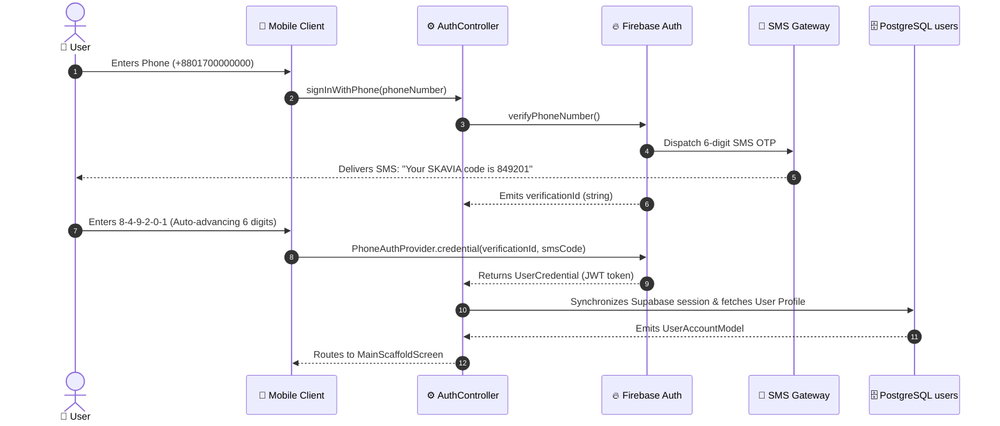
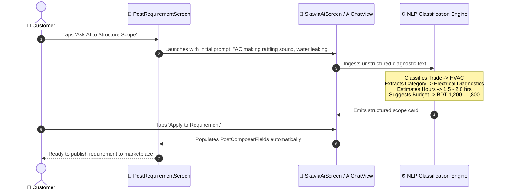

# SKAVIA — API & External Integration Architecture Guide

<p align="center">
  
</p>

<p align="center">
  <strong>Comprehensive Technical Integration Manual: Supabase PostgREST, Realtime WebSockets, SSLCommerz v4, Firebase Auth & Storage</strong><br>
  <em>Production Standard • High-Concurrency Architecture</em>
</p>

---

## 📑 1. Integration Ecosystem Overview

The SKAVIA platform orchestrates multiple best-in-class cloud and payment infrastructures:



---

## 💳 2. Payment Gateway Integration: SSLCommerz v4 & MFS

### Sequence Diagram: Payment Initialization, Redirect & Atomic Settlement



### SSLCommerz Sandbox Request Payload:
```json
{
  "store_id": "skaviabox",
  "store_passwd": "skavia_sandbox_secret",
  "total_amount": 1500.00,
  "currency": "BDT",
  "tran_id": "SKV-20261109-0012",
  "success_url": "https://api.skavia.com/payment/success",
  "fail_url": "https://api.skavia.com/payment/fail",
  "cancel_url": "https://api.skavia.com/payment/cancel",
  "cus_name": "Rahim Ahmed",
  "cus_email": "rahim@skavia.com",
  "cus_phone": "+8801700000000",
  "cus_add1": "House 14, Road 5, Banani",
  "cus_city": "Dhaka",
  "shipping_method": "NO"
}
```

---

## 💬 3. Real-Time Chat WebSocket Integration (Supabase Realtime)

### Sequence Diagram: Live Message Transmission & Status Delivery



---

## 📱 4. Firebase Authentication: Phone SMS OTP Handshake



---

## 🤖 5. SKAVIA AI Requirement Decomposition Architecture



---

## 🌐 6. Environment Configurations (`.env`)

```env
# Supabase Cloud Gateway
SUPABASE_URL=https://your-project.supabase.co
SUPABASE_ANON_KEY=eyJhbGciOi...

# Firebase Cloud Engine
FIREBASE_PROJECT_ID=skavia-prod
FIREBASE_STORAGE_BUCKET=gs://skavia-prod.appspot.com

# SSLCommerz Payment Gateway
SSLCOMMERZ_STORE_ID=skaviabox
SSLCOMMERZ_STORE_PASSWORD=skavia_sandbox_secret
SSLCOMMERZ_IS_SANDBOX=true

# AI Engine
SKAVIA_AI_MODEL=llama-3.3-70b-versatile
```
