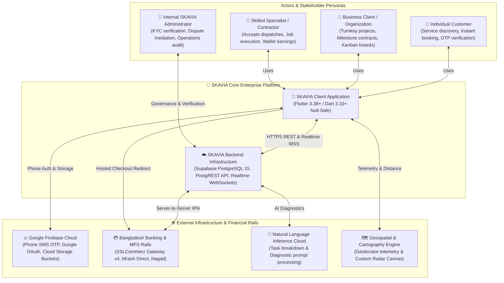
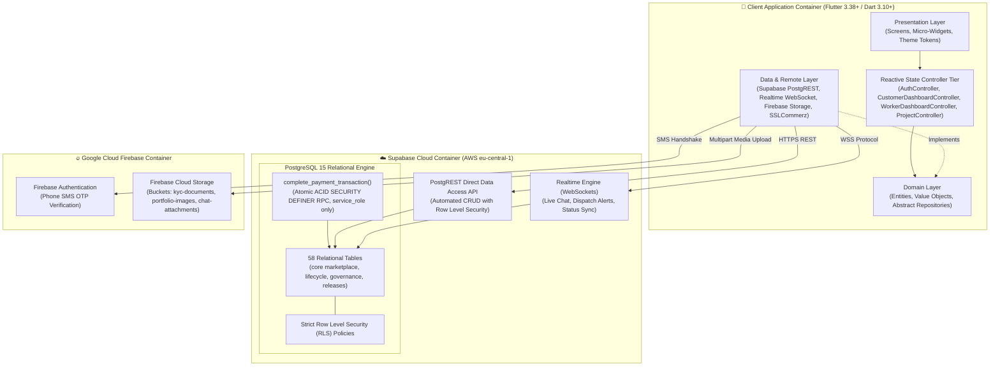
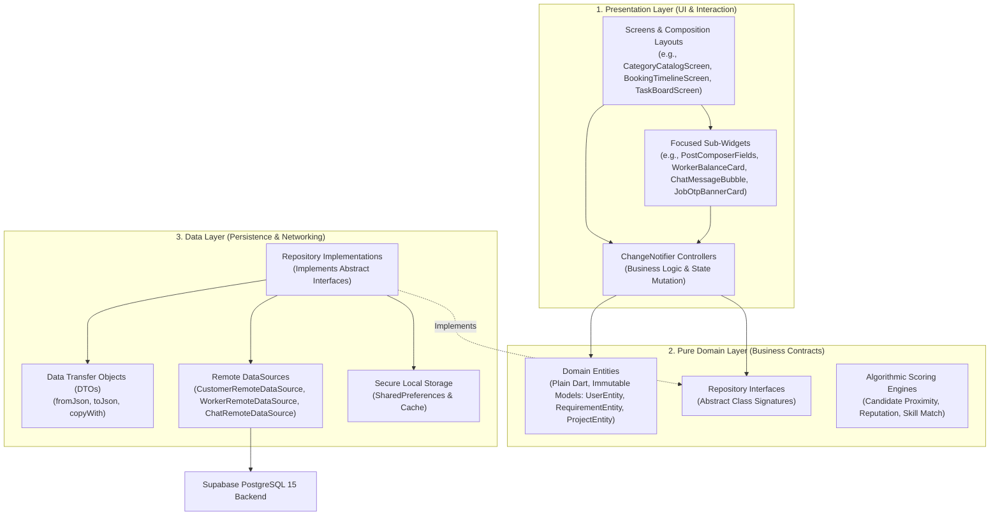
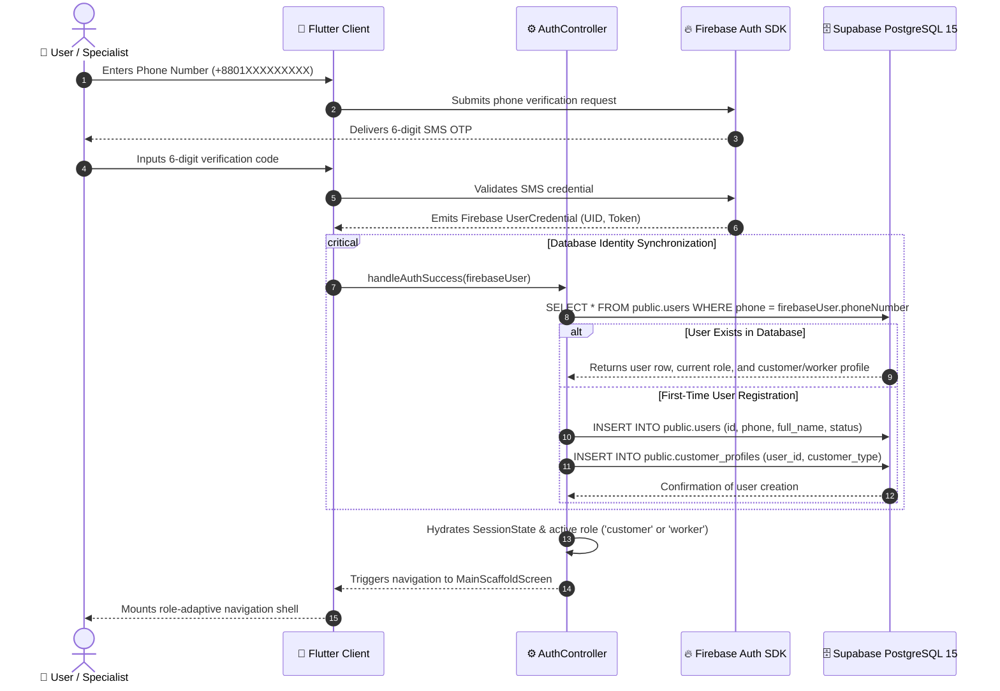
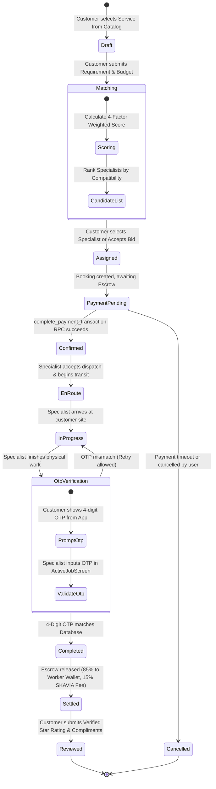
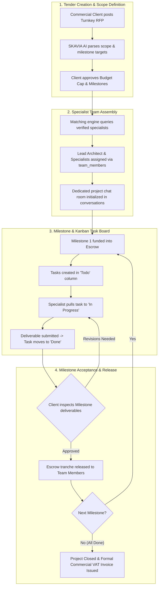
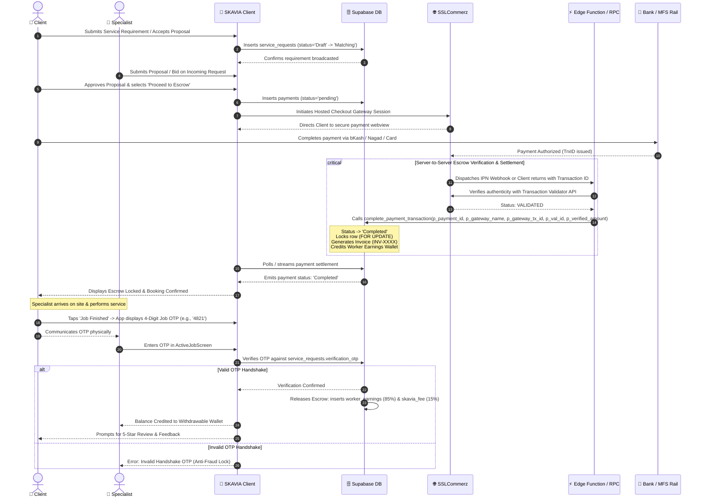
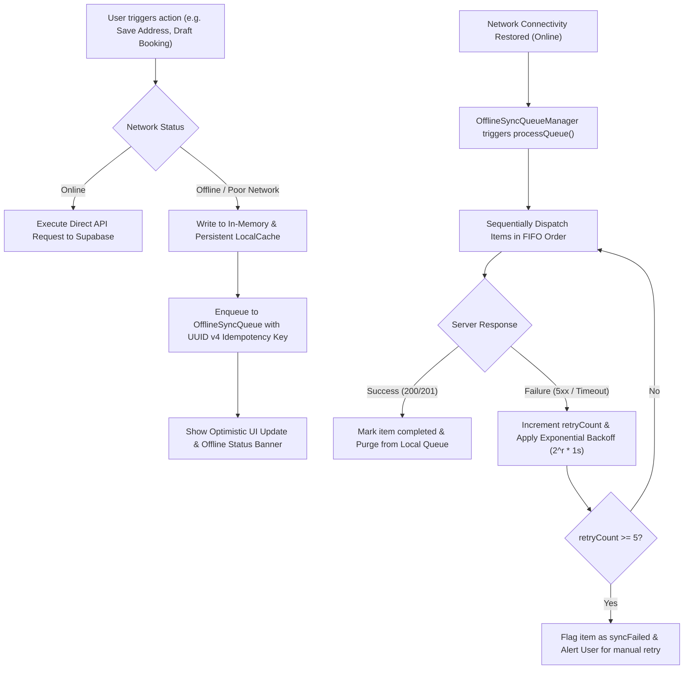

# SKAVIA — System Architecture & Technical Blueprint

<p align="center">
  
</p>

<p align="center">
  <strong>Enterprise Clean Architecture, Reactive State Management & Multi-Cloud Infrastructure Specification</strong><br>
  <em>Production Standard • Architecture Classification: Feature-First Domain-Driven Design (DDD)</em>
</p>

<p align="center">
  
  
  
  
  
  
  
</p>

---

## 📑 1. Architectural Philosophy & C4 System Context

SKAVIA is engineered on the foundational principles of **Feature-First Domain-Driven Design (DDD)**, **High Cohesion**, **Loose Coupling**, and **Zero-Trust Cloud Boundaries**. The client mobile application treats the client runtime environment as untrusted, delegating authoritative business validation and financial settlement strictly to PostgreSQL Row Level Security (RLS) policies, Edge Functions (`service_role`), and transactional database procedures.

SKAVIA is designed as **one unified enterprise** operating **9 internal DB specialization branches** (`TECH`, `HOME`, `CORP`, `AGRI`, `LOGI`, `DIGI`, `BIZ`, `CONS`, `EVNT`, with `8` consumer-facing branches presented on the public website and `CORP` representing enterprise operations) across **58 PostgreSQL tables** (34 core schema tables + 24 lifecycle, offline-sync, admin-governance, invitation, passkey, and app-release tables across 8 migrations), rather than an external multi-tenant SaaS. Its web administration and public landing portal live separately in [`admin-web/`](file:///c:/Users/TIMON/Desktop/SKAVIA/admin-web/) (`superadmin.skavia.com`, `admin.skavia.com`, `www.skavia.com`), decoupled from the Flutter consumer/worker mobile application (`lib/`).

### C4 Model — Level 1: System Context Diagram



---

### C4 Model — Level 2: Container Architecture Diagram



---

## 🏛️ 2. Clean Architecture Tier Breakdown

Every feature inside `lib/features/` follows strict three-tier clean separation:



### Architectural Invariants:
1. **Unidirectional Dependency:** Dependencies point strictly inward. Domain knows nothing of Flutter, UI packages, or third-party SDKs.
2. **Deterministic Testability:** Because controllers depend on abstract repository interfaces, any repository can be mocked in unit tests without touching a network socket.
3. **Immutability by Default:** All entities and DTOs provide immutable properties with copy methods (`copyWith`) preventing unexpected side effects during reactive state broadcasts.
4. **Preventing Oversized Files:** Large UI views are split into dedicated, single-responsibility sub-widgets (e.g., separating input bars, rating selectors, and cards into standalone presentation files).

---

## 🔄 3. Dual-Identity & Authentication Synchronization

SKAVIA separates **Firebase Auth** (Flutter mobile client sessions) and **Supabase PostgreSQL 15** identity records. Note that `/functions/v1/analyze-requirement` already verifies Firebase RS256 ID Tokens directly, whereas direct mobile PostgREST/Storage queries currently use the publishable key without minting a Supabase session JWT (meaning Supabase Third-Party Firebase Auth + `auth.jwt() ->> 'sub'` RLS alignment is an explicit pre-production requirement before enabling strict `auth.uid()` enforcement for mobile clients).



---

## ⚙️ 4. On-Demand Service Request Lifecycle State Machine



---

## 🏢 5. Turnkey Commercial Project Lifecycle



---

## 💳 6. Financial & Escrow Settlement Architecture

SKAVIA incorporates strict financial anti-tampering rules: **clients cannot update payment statuses directly**, and **workers cannot withdraw funds until physical inspection is validated via a 4-digit Job OTP**.



---

## 🧠 7. Core Applied Algorithms & Systems

SKAVIA uses well-tested software engineering algorithms to power candidate recommendation, distance calculation, fraud protection, financial settlement, and offline synchronization:

1. **4-Factor Weighted Candidate Matching Algorithm:**
   Ranks available specialists using four practical factors: verified skill overlap (40%), geographic proximity (25%), past customer ratings & completed jobs (20%), and rate alignment with client budget (15%).

2. **Haversine Geodetic Distance Algorithm:**
   Calculates exact real-world distance in kilometers between customer and technician coordinates across the Earth's curvature on device without incurring external map API costs.

3. **Cryptographic 4-Digit Handshake OTP Verification:**
   A secure random 4-digit code displayed only on the customer's phone. When the technician finishes the job on site, the customer provides the code to enter in the app, preventing false job completion claims.

4. **Idempotent Atomic Settlement Algorithm:**
   Executed in the PostgreSQL stored procedure `complete_payment_transaction`. Uses database row locking to prevent duplicate payouts, splits amounts automatically (85% worker earnings, 15% platform fee), and rolls back on any error.

5. **Radar Sweep Polar Projection:**
   Converts real-world GPS coordinates into screen canvas pixels, displaying nearby technicians with animated sweeps on a circular radar display.

6. **Exponential Backoff Offline Sync Algorithm:**
   Queues offline actions with unique UUID idempotency keys. When connection returns, it processes queued actions with doubling retry delays (1s, 2s, 4s, 8s) to prevent duplicate transactions and network flooding.

### 7.6 Offline-First Resilience & Sync Queue Architecture
SKAVIA implements an industrial-grade offline sync engine guaranteeing zero data loss:



---

## 📂 8. Modular Project Structure

```
SKAVIA/
├── admin-web/               # Separate Next.js 15 Public Website, Super Admin & Internal Admin Portals
├── android/                 # Android Native Host (Manifest, Permissions, FileProvider, Audio)
├── ios/                     # iOS Native Host (Info.plist, Permissions, Audio)
├── assets/                  # High-density logos, emblems, and audio chimes
│   ├── images/              # skavia_logo.png, skavia_emblem.png, google_logo.png
│   └── sounds/              # notification_sound.wav
├── docs/                    # Consolidated Engineering & Operations Documentation
│   ├── ARCHITECTURE.md      # This specification
│   ├── DATABASE_SCHEMA.md   # PostgreSQL 15 ER model (58 tables across 8 migrations), RLS & RPC specs
│   ├── APP_RELEASE_AND_UPDATE_ARCHITECTURE.md # Signed APK verification, public delivery & in-app auto-update
│   └── DEPLOYMENT_GUIDE.md  # Supabase migrations, Vercel setup & Android release build instructions
├── lib/
│   ├── app/                 # App lifecycle, router, theme, bootstrap
│   │   ├── bootstrap.dart   # App initialization, Supabase/Firebase/Notifications/Sync
│   │   ├── router/          # AppRouter, AppRoutes, RouteGuards
│   │   └── theme/           # AppColors, AppTypography, AppDimensions, SkaviaSurfaceTokens
│   ├── core/                # Core platform services, utilities, and constants
│   │   ├── constants/       # App-wide fixed definitions
│   │   ├── network/         # NetworkConnectivityService, OfflineSyncQueueManager, OfflineSyncReplayHandler
│   │   ├── services/        # NotificationService, LocationService, FeatureEligibilityService, MediaPickerService
│   │   ├── storage/         # LocalCacheService, SecureStorageService, RemoteStorageDataSource
│   │   └── utils/           # Formatters, CategoryResolver, JobOtpUtil, UuidUtil, Validators
│   ├── data/                # Global tables and shared data infrastructure
│   ├── features/            # Feature-first domain modules
│   │   ├── admin/           # Mobile admin controllers & governance views (guarded)
│   │   ├── ai_assistant/    # SKAVIA AI diagnostic assistant
│   │   ├── app_update/      # In-app APK update checker, SHA-256 verifier & installer bridge
│   │   ├── authentication/  # Login, OTP verification, 4-role onboarding, dual-identity
│   │   ├── billing/         # Escrow checkout, invoices, transaction history, fee calculator
│   │   ├── chat/            # WebSocket real-time messaging
│   │   ├── customer/        # Post requirement, catalog, live job feed, booking
│   │   ├── matching/        # Algorithmic multi-trade candidate scoring
│   │   ├── navigation/      # MainScaffoldScreen, role-adaptive switcher
│   │   ├── notifications/   # In-app notification center, category filters, dedup
│   │   ├── profile/         # User lifecycle, avatar/cover crop, addresses, completion engine, privacy
│   │   ├── reviews/         # 1-5 star ratings, complaints, reputation scorecard
│   │   ├── team_project/    # Turnkey commercial projects, Kanban board, teams
│   │   └── worker/          # Dispatch feed, active job OTP, earnings, schedule
│   ├── shared/              # Cross-cutting UI widgets, dialogs, and cropper screen
│   │   ├── dialogs/         # FeatureGateDialog, NotificationPermissionSheet, AccountDeletionDialog
│   │   ├── screens/         # ImageCropResizeScreen (1:1 avatar & 16:9 cover crop)
│   │   └── widgets/         # AppButton, AppTextField, OfflineSyncBanner, RadarMapSheet
│   └── main.dart            # Application entrypoint
├── supabase/                # Cloud Supabase configurations, Edge Functions & SQL assets
│   ├── functions/           # Deno Edge Functions (analyze-requirement, verify-sslcommerz-ipn)
│   └── migrations/          # 8 version-controlled idempotent SQL migrations
├── test/
│   └── unit/                # 17 Automated Flutter test suites (152 tests) + admin-web Vitest/Playwright suites (25 tests)
├── .env.example             # Environment template
├── analysis_options.yaml    # Strict Dart analyzer and linter configuration
└── pubspec.yaml             # Flutter project manifest & dependency locks
```
