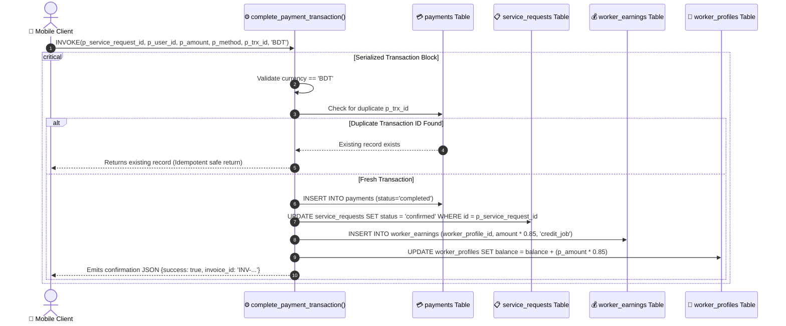
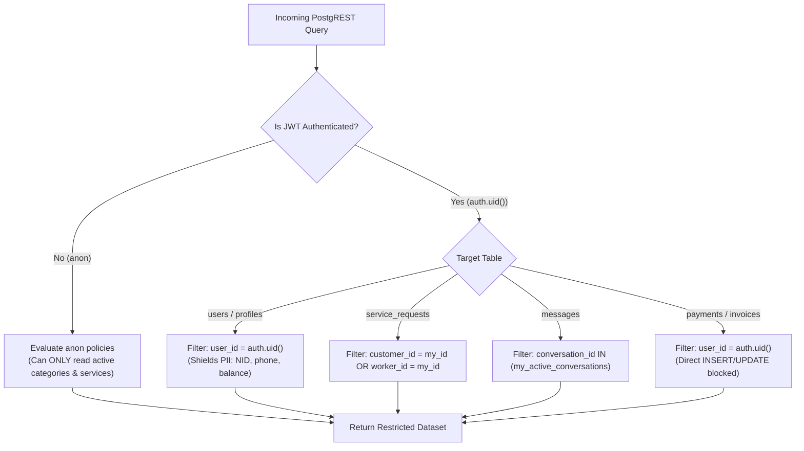

# SKAVIA — Relational Database Schema & PostgreSQL Specification

<p align="center">
  
</p>

<p align="center">
  <strong>Complete Relational Data Model, Row Level Security (RLS) Architecture & Atomic RPC Settlement</strong><br>
  <em>Engine: PostgreSQL 15 (Supabase Cloud) • 34 Production Relational Tables • Single-Enterprise Architecture</em>
</p>

---

## 📑 1. Database Architecture & Functional Clusters

The database tier of **SKAVIA** is built on **PostgreSQL 15** managed through **Supabase Cloud**. The schema is strictly modeled in Third Normal Form (3NF) partitioned into 8 functional domain clusters:

1. **Organizational Hierarchy & Identity (5 Tables):** `branches`, `users`, `user_roles`, `customer_profiles`, `worker_profiles`.
2. **Taxonomy & SKU Service Catalog (3 Tables):** `categories`, `services`, `service_addons`.
3. **Customer Demand & Bidding (2 Tables):** `requirements`, `requirement_bids`.
4. **On-Demand Dispatch & Live Telemetry (3 Tables):** `service_requests`, `service_request_status_history`, `service_request_coordinates`.
5. **Turnkey Commercial Projects & Kanban (5 Tables):** `projects`, `project_milestones`, `tasks`, `teams`, `team_members`.
6. **Real-Time Communication & Presence (3 Tables):** `conversations`, `conversation_participants`, `messages`.
7. **Billing, Financial Ledger & Escrow (4 Tables):** `payments`, `invoices`, `worker_earnings`, `escrow_accounts`.
8. **Trust, Quality Assurance & Operations (9 Tables):** `reviews`, `worker_reputations`, `disputes`, `dispute_messages`, `worker_verifications`, `audit_logs`, `notification_logs`, `user_locations`, `app_configurations`.

---

## 🗄️ 2. Master Entity-Relationship (ER) Diagram (34 Tables)

```mermaid
erDiagram
    BRANCHES ||--o{ CATEGORIES : "organizes"
    BRANCHES ||--o{ USER_ROLES : "assigns"
    USERS ||--o| CUSTOMER_PROFILES : "has profile"
    USERS ||--o| WORKER_PROFILES : "has profile"
    USERS ||--o{ USER_ROLES : "holds"
    USERS ||--o{ USER_LOCATIONS : "saves"
    USERS ||--o{ NOTIFICATION_LOGS : "receives"
    USERS ||--o{ AUDIT_LOGS : "audited in"
    
    CATEGORIES ||--o{ SERVICES : "contains"
    SERVICES ||--o{ SERVICE_ADDONS : "provides"
    
    CUSTOMER_PROFILES ||--o{ REQUIREMENTS : "posts"
    CUSTOMER_PROFILES ||--o{ SERVICE_REQUESTS : "orders"
    CUSTOMER_PROFILES ||--o{ PROJECTS : "commissions"
    
    WORKER_PROFILES ||--o{ REQUIREMENT_BIDS : "submits"
    WORKER_PROFILES ||--o{ SERVICE_REQUESTS : "fulfills"
    WORKER_PROFILES ||--o{ TEAM_MEMBERS : "joins"
    WORKER_PROFILES ||--o{ WORKER_EARNINGS : "accrues"
    WORKER_PROFILES ||--o| WORKER_REPUTATIONS : "maintains"
    WORKER_PROFILES ||--o| WORKER_VERIFICATIONS : "undergoes"
    
    REQUIREMENTS ||--o{ REQUIREMENT_BIDS : "receives"
    
    SERVICE_REQUESTS ||--o{ SERVICE_REQUEST_STATUS_HISTORY : "tracks"
    SERVICE_REQUESTS ||--o{ SERVICE_REQUEST_COORDINATES : "broadcasts"
    SERVICE_REQUESTS ||--o{ PAYMENTS : "funds"
    SERVICE_REQUESTS ||--o| REVIEWS : "generates"
    SERVICE_REQUESTS ||--o{ DISPUTES : "escalates"
    
    PROJECTS ||--o{ PROJECT_MILESTONES : "schedules"
    PROJECTS ||--o{ TASKS : "deconstructs"
    PROJECTS ||--o{ TEAM_MEMBERS : "employs"
    PROJECTS ||--o| ESCROW_ACCOUNTS : "locks"
    PROJECTS ||--o{ PAYMENTS : "draws"
    
    TEAMS ||--o{ TEAM_MEMBERS : "groups"
    
    PAYMENTS ||--o| INVOICES : "issues"
    
    CONVERSATIONS ||--o{ CONVERSATION_PARTICIPANTS : "includes"
    CONVERSATIONS ||--o{ MESSAGES : "contains"
    USERS ||--o{ CONVERSATION_PARTICIPANTS : "joins"
    USERS ||--o{ MESSAGES : "authors"
    
    DISPUTES ||--o{ DISPUTE_MESSAGES : "contains"
```



---

## 📋 3. Comprehensive Data Dictionary (34 Tables)

### Cluster 1: Organizational Hierarchy & Identity
```sql
-- 1. Internal SKAVIA Branches
CREATE TABLE public.branches (
    id UUID PRIMARY KEY DEFAULT uuid_generate_v4(),
    code VARCHAR(10) UNIQUE NOT NULL, -- 'TECH', 'HOME', 'CORP'
    name VARCHAR(100) NOT NULL,
    description TEXT,
    created_at TIMESTAMPTZ NOT NULL DEFAULT timezone('utc', now())
);

-- 2. Core Users Table
CREATE TABLE public.users (
    id UUID PRIMARY KEY DEFAULT uuid_generate_v4(),
    email VARCHAR(255) UNIQUE,
    phone VARCHAR(30) UNIQUE NOT NULL,
    full_name VARCHAR(150) NOT NULL,
    avatar_url TEXT,
    status VARCHAR(20) NOT NULL DEFAULT 'active', -- 'active', 'suspended', 'pending'
    created_at TIMESTAMPTZ NOT NULL DEFAULT timezone('utc', now())
);

-- 3. Role Assignments
CREATE TABLE public.user_roles (
    id UUID PRIMARY KEY DEFAULT uuid_generate_v4(),
    user_id UUID NOT NULL REFERENCES public.users(id) ON DELETE CASCADE,
    role VARCHAR(30) NOT NULL, -- 'customer', 'worker', 'company_admin', 'super_admin'
    branch_id UUID REFERENCES public.branches(id) ON DELETE SET NULL,
    created_at TIMESTAMPTZ NOT NULL DEFAULT timezone('utc', now()),
    UNIQUE(user_id, role)
);

-- 4. Customer Profiles
CREATE TABLE public.customer_profiles (
    id UUID PRIMARY KEY DEFAULT uuid_generate_v4(),
    user_id UUID UNIQUE NOT NULL REFERENCES public.users(id) ON DELETE CASCADE,
    customer_type VARCHAR(30) NOT NULL DEFAULT 'individual', -- 'individual', 'business', 'organization'
    company_name VARCHAR(200),
    tax_id VARCHAR(50),
    billing_address TEXT
);

-- 5. Worker Profiles
CREATE TABLE public.worker_profiles (
    id UUID PRIMARY KEY DEFAULT uuid_generate_v4(),
    user_id UUID UNIQUE NOT NULL REFERENCES public.users(id) ON DELETE CASCADE,
    trade_title VARCHAR(100) NOT NULL,
    hourly_rate NUMERIC(10, 2) NOT NULL DEFAULT 0.00,
    experience_years INT NOT NULL DEFAULT 1,
    rating NUMERIC(3, 2) NOT NULL DEFAULT 5.00,
    completed_jobs INT NOT NULL DEFAULT 0,
    availability VARCHAR(20) NOT NULL DEFAULT 'available', -- 'available', 'busy', 'offline'
    balance NUMERIC(12, 2) NOT NULL DEFAULT 0.00,
    is_verified BOOLEAN NOT NULL DEFAULT false
);
```

### Cluster 2: Taxonomy & SKU Service Catalog
```sql
-- 6. Service Categories
CREATE TABLE public.categories (
    id UUID PRIMARY KEY DEFAULT uuid_generate_v4(),
    branch_id UUID NOT NULL REFERENCES public.branches(id) ON DELETE CASCADE,
    name VARCHAR(100) NOT NULL,
    slug VARCHAR(100) UNIQUE NOT NULL,
    icon_name VARCHAR(50),
    is_active BOOLEAN NOT NULL DEFAULT true
);

-- 7. Standardized Services (SKUs)
CREATE TABLE public.services (
    id UUID PRIMARY KEY DEFAULT uuid_generate_v4(),
    category_id UUID NOT NULL REFERENCES public.categories(id) ON DELETE CASCADE,
    name VARCHAR(150) NOT NULL,
    base_price NUMERIC(10, 2) NOT NULL,
    estimated_hours NUMERIC(4, 1) NOT NULL DEFAULT 1.0,
    warranty_days INT NOT NULL DEFAULT 7,
    description TEXT
);

-- 8. Service Add-ons
CREATE TABLE public.service_addons (
    id UUID PRIMARY KEY DEFAULT uuid_generate_v4(),
    service_id UUID NOT NULL REFERENCES public.services(id) ON DELETE CASCADE,
    name VARCHAR(100) NOT NULL,
    price NUMERIC(10, 2) NOT NULL
);
```

### Cluster 3: Customer Demand & Bidding
```sql
-- 9. Customer Requirements
CREATE TABLE public.requirements (
    id UUID PRIMARY KEY DEFAULT uuid_generate_v4(),
    customer_id UUID NOT NULL REFERENCES public.customer_profiles(id) ON DELETE CASCADE,
    branch_id UUID NOT NULL REFERENCES public.branches(id),
    category_id UUID NOT NULL REFERENCES public.categories(id),
    title VARCHAR(200) NOT NULL,
    description TEXT NOT NULL,
    budget NUMERIC(10, 2) NOT NULL,
    urgency VARCHAR(20) NOT NULL DEFAULT 'standard', -- 'standard', 'urgent', 'scheduled'
    status VARCHAR(20) NOT NULL DEFAULT 'open', -- 'open', 'bidding', 'assigned', 'closed'
    created_at TIMESTAMPTZ NOT NULL DEFAULT timezone('utc', now())
);

-- 10. Worker Bids on Requirements
CREATE TABLE public.requirement_bids (
    id UUID PRIMARY KEY DEFAULT uuid_generate_v4(),
    requirement_id UUID NOT NULL REFERENCES public.requirements(id) ON DELETE CASCADE,
    worker_profile_id UUID NOT NULL REFERENCES public.worker_profiles(id) ON DELETE CASCADE,
    bid_amount NUMERIC(10, 2) NOT NULL,
    proposal TEXT NOT NULL,
    status VARCHAR(20) NOT NULL DEFAULT 'submitted', -- 'submitted', 'shortlisted', 'accepted', 'rejected'
    created_at TIMESTAMPTZ NOT NULL DEFAULT timezone('utc', now())
);
```

### Cluster 4: On-Demand Dispatch & Live Telemetry
```sql
-- 11. Service Requests (Bookings)
CREATE TABLE public.service_requests (
    id UUID PRIMARY KEY DEFAULT uuid_generate_v4(),
    customer_id UUID NOT NULL REFERENCES public.customer_profiles(id),
    worker_profile_id UUID REFERENCES public.worker_profiles(id),
    service_id UUID REFERENCES public.services(id),
    scheduled_at TIMESTAMPTZ NOT NULL,
    status VARCHAR(30) NOT NULL DEFAULT 'pending', -- 'pending', 'confirmed', 'in_progress', 'completed', 'cancelled'
    total_amount NUMERIC(10, 2) NOT NULL,
    verification_otp VARCHAR(6) NOT NULL, -- 4-digit or 6-digit handshake OTP
    created_at TIMESTAMPTZ NOT NULL DEFAULT timezone('utc', now())
);

-- 12. Request Status History
CREATE TABLE public.service_request_status_history (
    id UUID PRIMARY KEY DEFAULT uuid_generate_v4(),
    service_request_id UUID NOT NULL REFERENCES public.service_requests(id) ON DELETE CASCADE,
    old_status VARCHAR(30),
    new_status VARCHAR(30) NOT NULL,
    changed_at TIMESTAMPTZ NOT NULL DEFAULT timezone('utc', now())
);

-- 13. Real-time GPS Coordinates
CREATE TABLE public.service_request_coordinates (
    id UUID PRIMARY KEY DEFAULT uuid_generate_v4(),
    service_request_id UUID NOT NULL REFERENCES public.service_requests(id) ON DELETE CASCADE,
    worker_id UUID NOT NULL REFERENCES public.worker_profiles(id),
    latitude NUMERIC(10, 7) NOT NULL,
    longitude NUMERIC(10, 7) NOT NULL,
    recorded_at TIMESTAMPTZ NOT NULL DEFAULT timezone('utc', now())
);
```

### Cluster 5: Turnkey Commercial Projects & Kanban
```sql
-- 14. Turnkey Commercial Projects
CREATE TABLE public.projects (
    id UUID PRIMARY KEY DEFAULT uuid_generate_v4(),
    client_id UUID NOT NULL REFERENCES public.customer_profiles(id),
    title VARCHAR(200) NOT NULL,
    budget NUMERIC(12, 2) NOT NULL,
    start_date DATE NOT NULL,
    end_date DATE,
    status VARCHAR(30) NOT NULL DEFAULT 'planning', -- 'planning', 'in_progress', 'review', 'completed'
    created_at TIMESTAMPTZ NOT NULL DEFAULT timezone('utc', now())
);

-- 15. Project Milestones
CREATE TABLE public.project_milestones (
    id UUID PRIMARY KEY DEFAULT uuid_generate_v4(),
    project_id UUID NOT NULL REFERENCES public.projects(id) ON DELETE CASCADE,
    title VARCHAR(150) NOT NULL,
    amount NUMERIC(12, 2) NOT NULL,
    due_date DATE NOT NULL,
    status VARCHAR(30) NOT NULL DEFAULT 'pending' -- 'pending', 'funded', 'in_review', 'released'
);

-- 16. Kanban Project Tasks
CREATE TABLE public.tasks (
    id UUID PRIMARY KEY DEFAULT uuid_generate_v4(),
    project_id UUID NOT NULL REFERENCES public.projects(id) ON DELETE CASCADE,
    title VARCHAR(200) NOT NULL,
    description TEXT,
    assignee_id UUID REFERENCES public.worker_profiles(id),
    status VARCHAR(30) NOT NULL DEFAULT 'todo', -- 'todo', 'in_progress', 'review', 'done'
    priority VARCHAR(20) NOT NULL DEFAULT 'medium', -- 'low', 'medium', 'high', 'urgent'
    due_date DATE
);

-- 17. Specialist Assemblies (Teams)
CREATE TABLE public.teams (
    id UUID PRIMARY KEY DEFAULT uuid_generate_v4(),
    name VARCHAR(100) NOT NULL,
    lead_id UUID REFERENCES public.worker_profiles(id),
    created_at TIMESTAMPTZ NOT NULL DEFAULT timezone('utc', now())
);

-- 18. Project Team Members
CREATE TABLE public.team_members (
    id UUID PRIMARY KEY DEFAULT uuid_generate_v4(),
    project_id UUID NOT NULL REFERENCES public.projects(id) ON DELETE CASCADE,
    worker_profile_id UUID NOT NULL REFERENCES public.worker_profiles(id),
    role_in_project VARCHAR(100) NOT NULL,
    joined_at TIMESTAMPTZ NOT NULL DEFAULT timezone('utc', now()),
    UNIQUE(project_id, worker_profile_id)
);
```

### Cluster 6: Real-Time Communication & Presence
```sql
-- 19. Conversations
CREATE TABLE public.conversations (
    id UUID PRIMARY KEY DEFAULT uuid_generate_v4(),
    project_id UUID REFERENCES public.projects(id) ON DELETE SET NULL,
    title VARCHAR(150),
    created_at TIMESTAMPTZ NOT NULL DEFAULT timezone('utc', now())
);

-- 20. Conversation Participants
CREATE TABLE public.conversation_participants (
    id UUID PRIMARY KEY DEFAULT uuid_generate_v4(),
    conversation_id UUID NOT NULL REFERENCES public.conversations(id) ON DELETE CASCADE,
    user_id UUID NOT NULL REFERENCES public.users(id) ON DELETE CASCADE,
    last_read_at TIMESTAMPTZ,
    UNIQUE(conversation_id, user_id)
);

-- 21. Real-Time Chat Messages
CREATE TABLE public.messages (
    id UUID PRIMARY KEY DEFAULT uuid_generate_v4(),
    conversation_id UUID NOT NULL REFERENCES public.conversations(id) ON DELETE CASCADE,
    sender_id UUID NOT NULL REFERENCES public.users(id),
    content TEXT NOT NULL,
    attachment_url TEXT,
    status VARCHAR(20) NOT NULL DEFAULT 'sent', -- 'sent', 'delivered', 'read'
    created_at TIMESTAMPTZ NOT NULL DEFAULT timezone('utc', now())
);
```

### Cluster 7: Billing, Financial Ledger & Escrow
```sql
-- 22. Payments Ledger
CREATE TABLE public.payments (
    id UUID PRIMARY KEY DEFAULT uuid_generate_v4(),
    service_request_id UUID REFERENCES public.service_requests(id),
    project_id UUID REFERENCES public.projects(id),
    user_id UUID NOT NULL REFERENCES public.users(id),
    amount NUMERIC(12, 2) NOT NULL,
    currency VARCHAR(10) NOT NULL DEFAULT 'BDT',
    payment_method VARCHAR(50) NOT NULL, -- 'bKash', 'Nagad', 'Card', 'SSLCommerz'
    transaction_id VARCHAR(100) UNIQUE NOT NULL,
    status VARCHAR(30) NOT NULL DEFAULT 'pending', -- 'pending', 'completed', 'failed', 'refunded'
    created_at TIMESTAMPTZ NOT NULL DEFAULT timezone('utc', now())
);

-- 23. VAT-Compliant Invoices
CREATE TABLE public.invoices (
    id UUID PRIMARY KEY DEFAULT uuid_generate_v4(),
    payment_id UUID UNIQUE NOT NULL REFERENCES public.payments(id),
    invoice_number VARCHAR(100) UNIQUE NOT NULL,
    total_amount NUMERIC(12, 2) NOT NULL,
    tax_amount NUMERIC(12, 2) NOT NULL,
    pdf_url TEXT,
    issued_at TIMESTAMPTZ NOT NULL DEFAULT timezone('utc', now())
);

-- 24. Worker Earnings Ledger
CREATE TABLE public.worker_earnings (
    id UUID PRIMARY KEY DEFAULT uuid_generate_v4(),
    worker_profile_id UUID NOT NULL REFERENCES public.worker_profiles(id) ON DELETE RESTRICT,
    amount NUMERIC(12, 2) NOT NULL,
    type VARCHAR(30) NOT NULL, -- 'credit_job', 'debit_withdrawal', 'commission_deduction'
    status VARCHAR(20) NOT NULL DEFAULT 'completed', -- 'pending', 'completed'
    reference_id VARCHAR(100),
    created_at TIMESTAMPTZ NOT NULL DEFAULT timezone('utc', now())
);

-- 25. Milestone Escrow Accounts
CREATE TABLE public.escrow_accounts (
    id UUID PRIMARY KEY DEFAULT uuid_generate_v4(),
    project_id UUID UNIQUE NOT NULL REFERENCES public.projects(id) ON DELETE RESTRICT,
    total_escrow NUMERIC(12, 2) NOT NULL,
    released_amount NUMERIC(12, 2) NOT NULL DEFAULT 0.00,
    balance NUMERIC(12, 2) NOT NULL
);
```

### Cluster 8: Trust, Quality Assurance & Operations
```sql
-- 26. Verified Reviews
CREATE TABLE public.reviews (
    id UUID PRIMARY KEY DEFAULT uuid_generate_v4(),
    service_request_id UUID UNIQUE NOT NULL REFERENCES public.service_requests(id),
    worker_profile_id UUID NOT NULL REFERENCES public.worker_profiles(id),
    customer_id UUID NOT NULL REFERENCES public.customer_profiles(id),
    rating INT NOT NULL CHECK (rating >= 1 AND rating <= 5),
    comment TEXT,
    compliments TEXT[],
    created_at TIMESTAMPTZ NOT NULL DEFAULT timezone('utc', now())
);

-- 27. Worker Reputation & Badging
CREATE TABLE public.worker_reputations (
    id UUID PRIMARY KEY DEFAULT uuid_generate_v4(),
    worker_profile_id UUID UNIQUE NOT NULL REFERENCES public.worker_profiles(id) ON DELETE CASCADE,
    score NUMERIC(5, 2) NOT NULL DEFAULT 100.00,
    badge_level VARCHAR(20) NOT NULL DEFAULT 'silver', -- 'silver', 'gold', 'diamond'
    on_time_rate NUMERIC(5, 2) NOT NULL DEFAULT 100.00,
    updated_at TIMESTAMPTZ NOT NULL DEFAULT timezone('utc', now())
);

-- 28. Escalated Disputes
CREATE TABLE public.disputes (
    id UUID PRIMARY KEY DEFAULT uuid_generate_v4(),
    service_request_id UUID NOT NULL REFERENCES public.service_requests(id),
    raised_by UUID NOT NULL REFERENCES public.users(id),
    reason VARCHAR(100) NOT NULL,
    status VARCHAR(30) NOT NULL DEFAULT 'opened', -- 'opened', 'in_mediation', 'resolved', 'closed'
    created_at TIMESTAMPTZ NOT NULL DEFAULT timezone('utc', now())
);

-- 29. Dispute Messages
CREATE TABLE public.dispute_messages (
    id UUID PRIMARY KEY DEFAULT uuid_generate_v4(),
    dispute_id UUID NOT NULL REFERENCES public.disputes(id) ON DELETE CASCADE,
    sender_id UUID NOT NULL REFERENCES public.users(id),
    message TEXT NOT NULL,
    created_at TIMESTAMPTZ NOT NULL DEFAULT timezone('utc', now())
);

-- 30. Worker KYC Document Submissions
CREATE TABLE public.worker_verifications (
    id UUID PRIMARY KEY DEFAULT uuid_generate_v4(),
    worker_profile_id UUID NOT NULL REFERENCES public.worker_profiles(id) ON DELETE CASCADE,
    nid_number VARCHAR(50) NOT NULL,
    nid_front_url TEXT NOT NULL,
    nid_back_url TEXT NOT NULL,
    status VARCHAR(30) NOT NULL DEFAULT 'submitted' -- 'submitted', 'verified', 'rejected'
);

-- 31. Security Audit Logs
CREATE TABLE public.audit_logs (
    id UUID PRIMARY KEY DEFAULT uuid_generate_v4(),
    user_id UUID REFERENCES public.users(id),
    action VARCHAR(100) NOT NULL,
    entity_type VARCHAR(50) NOT NULL,
    entity_id UUID,
    details JSONB,
    created_at TIMESTAMPTZ NOT NULL DEFAULT timezone('utc', now())
);

-- 32. Notification Delivery Logs
CREATE TABLE public.notification_logs (
    id UUID PRIMARY KEY DEFAULT uuid_generate_v4(),
    user_id UUID NOT NULL REFERENCES public.users(id) ON DELETE CASCADE,
    title VARCHAR(200) NOT NULL,
    body TEXT NOT NULL,
    channel VARCHAR(50) NOT NULL,
    delivered_at TIMESTAMPTZ NOT NULL DEFAULT timezone('utc', now())
);

-- 33. Saved User Addresses & Zones
CREATE TABLE public.user_locations (
    id UUID PRIMARY KEY DEFAULT uuid_generate_v4(),
    user_id UUID NOT NULL REFERENCES public.users(id) ON DELETE CASCADE,
    label VARCHAR(50) NOT NULL, -- 'Home', 'Office', 'Warehouse'
    address TEXT NOT NULL,
    zone VARCHAR(100) NOT NULL, -- 'Gulshan', 'Dhanmondi', 'Uttara'
    latitude NUMERIC(10, 7) NOT NULL,
    longitude NUMERIC(10, 7) NOT NULL,
    is_default BOOLEAN NOT NULL DEFAULT false
);

-- 34. Dynamic Platform Configurations
CREATE TABLE public.app_configurations (
    id UUID PRIMARY KEY DEFAULT uuid_generate_v4(),
    key VARCHAR(100) UNIQUE NOT NULL,
    value JSONB NOT NULL,
    updated_at TIMESTAMPTZ NOT NULL DEFAULT timezone('utc', now())
);
```

---

## 🔒 4. Atomic Financial Settlement RPC

To prevent client-side payment tampering or race conditions, financial settlement executes via a PostgreSQL `SECURITY DEFINER` function:



```sql
CREATE OR REPLACE FUNCTION public.complete_payment_transaction(
    p_service_request_id UUID,
    p_user_id UUID,
    p_amount NUMERIC,
    p_method VARCHAR,
    p_trx_id VARCHAR,
    p_currency VARCHAR DEFAULT 'BDT'
) RETURNS JSONB
LANGUAGE plpgsql
SECURITY DEFINER
SET search_path = public
AS $$
DECLARE
    v_worker_id UUID;
    v_existing_payment_id UUID;
    v_invoice_id UUID;
    v_worker_share NUMERIC;
BEGIN
    -- 1. Strict Currency Assertion
    IF p_currency <> 'BDT' THEN
        RAISE EXCEPTION 'Currency must be BDT. Rejected: %', p_currency;
    END IF;

    -- 2. Idempotency Check
    SELECT id INTO v_existing_payment_id FROM public.payments WHERE transaction_id = p_trx_id;
    IF v_existing_payment_id IS NOT NULL THEN
        RETURN jsonb_build_object(
            'status', 'already_processed',
            'payment_id', v_existing_payment_id,
            'message', 'Transaction already settled'
        );
    END IF;

    -- 3. Lock & Query Service Request
    SELECT worker_profile_id INTO v_worker_id 
    FROM public.service_requests 
    WHERE id = p_service_request_id 
    FOR UPDATE;

    IF v_worker_id IS NULL THEN
        RAISE EXCEPTION 'Service Request % does not exist or has no assigned worker', p_service_request_id;
    END IF;

    -- 4. Insert Payment Record
    INSERT INTO public.payments (
        service_request_id, user_id, amount, currency, payment_method, transaction_id, status
    ) VALUES (
        p_service_request_id, p_user_id, p_amount, p_currency, p_method, p_trx_id, 'completed'
    ) RETURNING id INTO v_existing_payment_id;

    -- 5. Transition Service Request Status
    UPDATE public.service_requests 
    SET status = 'confirmed' 
    WHERE id = p_service_request_id;

    -- 6. Credit Worker Available Balance (85% Net Payout)
    v_worker_share := ROUND(p_amount * 0.85, 2);
    
    INSERT INTO public.worker_earnings (
        worker_profile_id, amount, type, status, reference_id
    ) VALUES (
        v_worker_id, v_worker_share, 'credit_job', 'completed', p_trx_id
    );

    UPDATE public.worker_profiles 
    SET balance = balance + v_worker_share 
    WHERE id = v_worker_id;

    -- 7. Generate Invoice
    INSERT INTO public.invoices (
        payment_id, invoice_number, total_amount, tax_amount
    ) VALUES (
        v_existing_payment_id, 
        'INV-' || to_char(now(), 'YYYYMMDD') || '-' || substr(p_trx_id, 1, 6),
        p_amount,
        ROUND(p_amount * 0.15, 2)
    ) RETURNING id INTO v_invoice_id;

    RETURN jsonb_build_object(
        'status', 'success',
        'payment_id', v_existing_payment_id,
        'invoice_id', v_invoice_id,
        'amount_settled', p_amount,
        'worker_credited', v_worker_share
    );
END;
$$;
```

---

## 🛡️ 5. Row-Level Security (RLS) Policy Architecture



---

## 🚀 6. User Lifecycle, Progressive Profile & Offline Sync Schema (Migration 20261110220000)

### 6.1 Extended User Lifecycle Fields (`public.users`)
```sql
ALTER TABLE public.users
    ADD COLUMN IF NOT EXISTS date_of_birth DATE,
    ADD COLUMN IF NOT EXISTS birthday_notifications_enabled BOOLEAN NOT NULL DEFAULT true,
    ADD COLUMN IF NOT EXISTS gender VARCHAR(30) DEFAULT 'unspecified',
    ADD COLUMN IF NOT EXISTS emergency_contact_name VARCHAR(120),
    ADD COLUMN IF NOT EXISTS emergency_contact_phone VARCHAR(30),
    ADD COLUMN IF NOT EXISTS preferred_language VARCHAR(10) NOT NULL DEFAULT 'en',
    ADD COLUMN IF NOT EXISTS timezone VARCHAR(50) NOT NULL DEFAULT 'Asia/Dhaka',
    ADD COLUMN IF NOT EXISTS account_status VARCHAR(30) NOT NULL DEFAULT 'active', -- 'active', 'suspended', 'deactivated'
    ADD COLUMN IF NOT EXISTS privacy_settings JSONB NOT NULL DEFAULT '{"profile_visibility": "public", "share_analytics": true}'::jsonb,
    ADD COLUMN IF NOT EXISTS notification_preferences JSONB NOT NULL DEFAULT '{"push": true, "email": true, "sms": true, "urgent": true, "booking": true, "marketing": false}'::jsonb,
    ADD COLUMN IF NOT EXISTS profile_completion_percentage INT NOT NULL DEFAULT 40;
```

### 6.2 New Operational Tables

```sql
-- 35. Detailed User Addresses (Multi-location, Geocoded)
CREATE TABLE public.user_addresses (
    id TEXT PRIMARY KEY DEFAULT gen_random_uuid()::text,
    user_id TEXT NOT NULL,
    label VARCHAR(60) NOT NULL, -- 'Home', 'Office', 'Warehouse'
    address_line1 TEXT NOT NULL,
    address_line2 TEXT,
    city VARCHAR(80) NOT NULL DEFAULT 'Dhaka',
    zone VARCHAR(80) NOT NULL, -- 'Gulshan', 'Dhanmondi', 'Uttara'
    postal_code VARCHAR(20),
    latitude DOUBLE PRECISION,
    longitude DOUBLE PRECISION,
    is_default BOOLEAN NOT NULL DEFAULT false,
    created_at TIMESTAMPTZ NOT NULL DEFAULT timezone('utc', now()),
    updated_at TIMESTAMPTZ NOT NULL DEFAULT timezone('utc', now())
);

-- 36. Active User Sessions (Audit & Device Control)
CREATE TABLE public.user_sessions (
    id TEXT PRIMARY KEY DEFAULT gen_random_uuid()::text,
    user_id TEXT NOT NULL,
    device_id VARCHAR(120) NOT NULL,
    device_model VARCHAR(120),
    platform VARCHAR(40), -- 'android', 'ios', 'web'
    ip_address VARCHAR(64),
    last_active_at TIMESTAMPTZ NOT NULL DEFAULT timezone('utc', now()),
    is_current BOOLEAN NOT NULL DEFAULT true,
    created_at TIMESTAMPTZ NOT NULL DEFAULT timezone('utc', now())
);

-- 37. Persistent Offline Synchronization Queue (Idempotent At-Least-Once Delivery)
CREATE TABLE public.offline_sync_queue (
    id TEXT PRIMARY KEY DEFAULT gen_random_uuid()::text,
    user_id TEXT NOT NULL,
    idempotency_key TEXT UNIQUE NOT NULL,
    operation_type VARCHAR(80) NOT NULL,
    payload JSONB NOT NULL,
    status VARCHAR(30) NOT NULL DEFAULT 'pending', -- 'pending', 'processing', 'completed', 'failed'
    retry_count INT NOT NULL DEFAULT 0,
    last_error TEXT,
    created_at TIMESTAMPTZ NOT NULL DEFAULT timezone('utc', now()),
    synced_at TIMESTAMPTZ
);

-- 38. Comprehensive In-App User Notifications (Deduplicated)
CREATE TABLE public.user_notifications (
    id TEXT PRIMARY KEY DEFAULT gen_random_uuid()::text,
    user_id TEXT NOT NULL,
    title VARCHAR(200) NOT NULL,
    body TEXT NOT NULL,
    category VARCHAR(50) NOT NULL DEFAULT 'general', -- 'urgent', 'booking', 'birthday', 'profile', 'security', 'general'
    action_route VARCHAR(200),
    metadata JSONB,
    dedup_key VARCHAR(120),
    is_read BOOLEAN NOT NULL DEFAULT false,
    created_at TIMESTAMPTZ NOT NULL DEFAULT timezone('utc', now())
);
```

### 6.3 Stored Procedures for Lifecycle & Feature Eligibility

1. **`calculate_profile_completion(p_user_id TEXT)`:**
   Calculates weighted completeness (Name 15%, Email 15%, Phone 10%, Avatar 10%, Saved Address 20%, DOB 15%, Emergency Contact 15%), updates `users.profile_completion_percentage`, and returns the integer score.
2. **`check_feature_eligibility(p_user_id TEXT, p_feature_name TEXT)`:**
   Evaluates access rules server-side before critical operations (`book_service`, `accept_job`, `request_payout`, `post_project`). Returns `{eligible: BOOLEAN, reason: TEXT, missing_requirement: TEXT}`.
