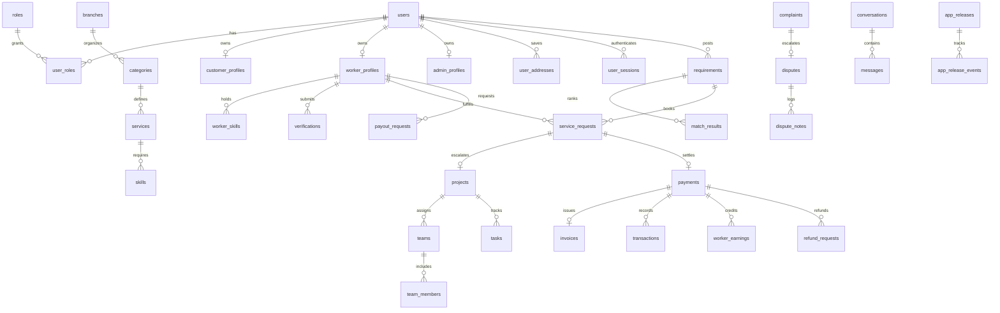

# SKAVIA — End-to-End System Data Design (v1.0.0)

> **Single Source of Truth** for the SKAVIA PostgreSQL (Supabase) data architecture, covering both the **Flutter Mobile App** (`lib/`) and the **Enterprise Admin Web Portal** (`admin-web/`).

---

## 1. Architectural Principles

1. **Domain-Driven Modularity:** All 54 tables are organized into **7 clean functional domains** (`supabase/schema/01_*.sql` – `07_*.sql`) plus unified security/indexes (`08_rls_functions_and_indexes.sql`), eliminating fragmented timestamped migrations.
2. **Strict Surface & Access Separation:**
   - **User / Mobile App (`public` tables with RLS):** Accessed by Flutter via Firebase Auth JWT + Supabase RLS (`auth.uid()::text`). Users can only read/write their own rows, public catalog/branches, and assigned bookings/messages.
   - **Admin Portal (`admin-web` via `service_role`):** Governance, RBAC, passkeys, audit logs, maker-checker approvals, payouts, and OTA release management are locked behind RLS (zero direct mobile client access) and accessed exclusively through authenticated Next.js API routes.
3. **Immutable & Atomic Guarantees:**
   - `audit_logs` is protected by a PostgreSQL trigger (`prevent_audit_log_mutation`) preventing `UPDATE` or `DELETE`.
   - Payment settlement & escrow splitting run atomically inside `complete_payment_transaction()`.
   - Zero fake/seed service or price data in production.

---

## 2. Entity-Relationship Overview

---

## 3. Structured Domain Breakdown (`supabase/schema/`)

| Part | File | Domain | Primary Consumer | Tables |
| :--- | :--- | :--- | :--- | :--- |
| **01** | `01_identity_and_rbac.sql` | Identity, Roles & Sessions | Flutter + Admin | `users`, `roles`, `user_roles`, `user_addresses`, `user_sessions`, `verifications` |

> **Note on `user_sessions` Dual Usage:**
> The `user_sessions` table serves two purposes:
> 1. **Active Device Sessions:** Normal authenticated sessions where `user_id` is the authenticated user's UUID.
> 2. **Pre-Auth OTP Challenges:** Temporary challenge entries where `user_id` contains a synthetic identifier (`otp_pending:<e164phone>` or `otp_pending:email:<email>`). The `user_sessions.token_hash` column stores the keyed HMAC-SHA256 hash of the 6-digit OTP, `device_id` holds the `verificationId`, `ip_address` tracks attempt counts (max 5 attempts before lockout), and `expires_at` enforces a strict 5-minute challenge window. Foreign key enforcement on `user_id` is omitted to support this pre-auth challenge workflow.
| **02** | `02_admin_governance.sql` | Admin RBAC, Passkeys & Security | Admin Web Only | `permissions`, `role_permissions`, `user_permission_overrides`, `admin_profiles`, `admin_branch_assignments`, `admin_invitations`, `admin_passkeys`, `webauthn_challenges`, `admin_login_events`, `audit_logs`, `security_incidents`, `system_settings`, `backup_verification_logs` |
| **03** | `03_catalog_and_branches.sql` | Branches & Service Taxonomy | Flutter + Admin | `branches`, `categories`, `services`, `skills` |
| **04** | `04_marketplace_and_operations.sql` | Profiles, Matching, Bookings & Teams | Flutter + Admin | `customer_profiles`, `worker_profiles`, `worker_skills`, `portfolio_items`, `certificates`, `availability_slots`, `requirements`, `requirement_skills`, `match_results`, `service_requests`, `projects`, `teams`, `team_members`, `tasks` |
| **05** | `05_finance_and_escrow.sql` | Payments, Escrow & Maker-Checker | Flutter + Admin | `payments`, `invoices`, `transactions`, `worker_earnings`, `commission_rules`, `maker_checker_approvals`, `payout_requests`, `refund_requests`, `reconciliation_runs` |
| **06** | `06_engagement_and_sync.sql` | Chat, Reviews, Disputes & Sync | Flutter + Admin | `conversations`, `messages`, `reviews`, `reputations`, `complaints`, `disputes`, `dispute_notes`, `notifications`, `user_notifications`, `offline_sync_queue` |
| **07** | `07_releases_and_ota.sql` | App Releases & OTA Telemetry | Flutter + Admin | `app_releases`, `app_release_events`, `storage.buckets('app-releases')` |
| **08** | `08_rls_functions_and_indexes.sql` | Security Policies, Storage, RPCs & Indexes | Database Engine | Storage buckets (`avatars`, `portfolios`, `certificates`, `verifications`, `attachments`), RLS policies, `prevent_audit_log_mutation`, `complete_payment_transaction`, `calculate_profile_completion`, `check_feature_eligibility`, B-Tree indexes |

---

## 4. Supabase Storage Buckets (Media & KYC)

| Bucket | Visibility | Purpose |
| :--- | :--- | :--- |
| `avatars` | Public Read | User profile pictures (`users.avatar_url`) & cover banners (`users.cover_url`) |
| `portfolios` | Public Read | Worker portfolio project showcase images |
| `certificates` | Public Read | Trade certificates & credentials |
| `verifications` | Private / Signed URL | NID front/back & KYC documents (`verifications.document_file_url`) |
| `attachments` | Public Read | Chat & feed post media attachments |
| `app-releases` | Private / Admin Gated | Signed production APK binaries (`07_releases_and_ota.sql`) |

---

## 4. User vs Admin Data Boundary

| Access Tier | Tables | Enforcement |
| :--- | :--- | :--- |
| **Public Read** | `branches`, `categories`, `services`, `skills`, `worker_profiles` (active), `reviews` | Supabase RLS `SELECT` (`true`) |
| **Owner-Scoped (User)** | `users`, `customer_profiles`, `user_addresses`, `user_sessions`, `requirements`, `service_requests`, `conversations`, `messages`, `user_notifications`, `offline_sync_queue`, `verifications` | `auth.uid()::text = user_id / client_id` |
| **Admin-Only Governance** | `admin_invitations`, `admin_passkeys`, `webauthn_challenges`, `admin_login_events`, `permissions`, `role_permissions`, `user_permission_overrides`, `maker_checker_approvals`, `reconciliation_runs`, `security_incidents`, `system_settings`, `backup_verification_logs`, `audit_logs` | RLS enabled with **no** `anon`/`authenticated` write policies; accessed only via `admin-web` (`SUPABASE_SERVICE_ROLE_KEY`) + FIDO2/Step-Up MFA |
