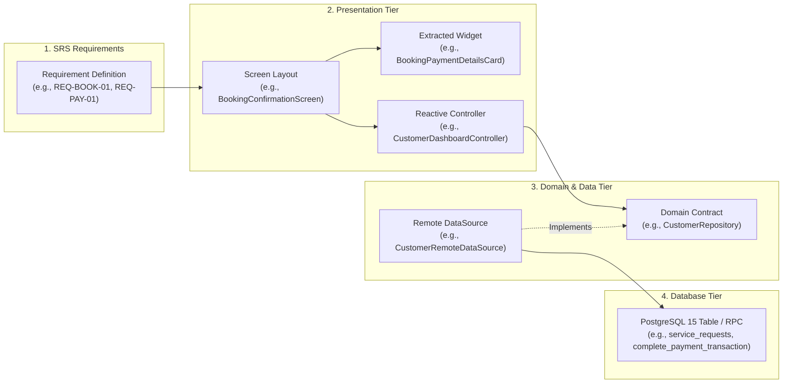

# SKAVIA — End-to-End Feature Traceability Matrix

  

  <strong>Comprehensive Systems Engineering Traceability: Functional Requirements, UI Widgets, Controllers, DataSources & PostgreSQL Tables</strong> 
  <em>Production Standard • Bidirectional Verification & Quality Assurance</em>

---

## 📑 1. Traceability Architecture

This matrix provides forward and backward traceability connecting High-Level User Requirements to Presentation Layer Screens, Extracted Modular Widgets, State Controllers, Domain Contracts, Remote DataSources, and PostgreSQL Database Tables:

---

## 📋 2. Comprehensive System Traceability Grid

| Req ID & Feature Name | UI Screen & Sub-Widgets | State Controller | Domain Contract | Data Layer DataSource | Database Entity / RPC | Automated Test Verification |
| :--- | :--- | :--- | :--- | :--- | :--- | :--- |
| **REQ-AUTH-01** Dual Login (Phone/Email) | `LoginScreen` `PhoneLoginForm` `EmailLoginForm` | `AuthController` | `AuthRepository` | `AuthRepositoryImpl` | `auth.users` `public.users` | `test/unit/phase_module_test.dart` |
| **REQ-AUTH-02** 6-Digit OTP Auto-Focus | `OtpVerificationScreen` | `AuthController` | `AuthRepository` | Firebase Phone Auth SDK | `public.users` | `test/unit/phase_module_test.dart` |
| **REQ-AUTH-03** Role Persona Onboarding | `RoleSelectionScreen` `OnboardingAuthSheet` | `AuthController` | `AuthRepository` | `AuthRepositoryImpl` | `customer_profiles` `worker_profiles` | `test/unit/phase_module_test.dart` |
| **REQ-CAT-01** Taxonomy Catalog & Search | `CategoryCatalogScreen` `CatalogSearchBar` `CatalogFilterPill` | `CustomerDashboardController` | `CustomerRepository` | `CustomerRemoteDataSource` | `categories` `services` | `test/unit/catalog_test.dart` |
| **REQ-POST-01** Requirement Stepper & AI | `PostRequirementScreen` `PostComposerFields` `PostRequirementAiButton` | `PostRequirementController` | `CustomerRepository` | `CustomerRemoteDataSource` | `requirements` `app_configurations` | `test/unit/phase_module_test.dart` |
| **REQ-MATCH-01** 4-Factor Algorithmic Match | `CandidateMatchesScreen` `CandidateMatchCard` `MatchScoreBadge` | `CustomerDashboardController` | `CustomerRepository` | Candidate Matching Engine | `worker_profiles` `worker_reputations` | `test/unit/matching_scoring_test.dart` |
| **REQ-BOOK-01** Order Summary & Timeline | `BookingConfirmationScreen` `BookingTimelineScreen` `BookingTimelineStep` | `CustomerDashboardController` | `CustomerRepository` | `CustomerRemoteDataSource` | `service_requests` `status_history` | `test/unit/phase_module_test.dart` |
| **REQ-PAY-01** Atomic Payment Settlement | `SimulatedCheckoutScreen` `InvoiceScreen` `PaymentSuccessScreen` | `CustomerDashboardController` | `CustomerRepository` | `CustomerRemoteDataSource` | `payments` `complete_payment_transaction` RPC | `test/unit/security_settlement_test.dart` |
| **REQ-OTP-01** 4-Digit Completion Handshake | `ActiveJobScreen` `JobOtpBannerCard` | `WorkerDashboardController` | `WorkerRepository` | `WorkerRemoteDataSource` | `service_requests.verification_otp` | `test/unit/security_settlement_test.dart` |
| **REQ-RADAR-01** Geolocated Proximity Radar | `RadarMapSheet` `RadarMapCanvas` | `CustomerDashboardController` | System Service | `service_request_coordinates` | `service_request_coordinates` | `test/unit/responsive_layout_test.dart` |
| **REQ-CHAT-01** Real-Time WebSocket Chat | `ChatRoomScreen` `ChatMessageBubble` `ChatInputBar` | `ChatController` | `ChatRepository` | `ChatRemoteDataSource` | `conversations` `messages` | `test/unit/chat_review_test.dart` |
| **REQ-REV-01** Verified Review & Rating | `SubmitReviewScreen` `ReviewWorkerCard` `ReviewRatingSelector` | `ReviewController` | `ReviewRepository` | `ReviewRemoteDataSource` | `reviews` `worker_reputations` | `test/unit/chat_review_test.dart` |
| **REQ-PROJ-01** Turnkey Commercial Projects | `ProjectDashboardScreen` `TaskBoardScreen` `TeamRosterScreen` | `ProjectController` | `ProjectRepository` | `ProjectRemoteDataSource` | `projects` `tasks` `project_milestones` | `test/unit/phase_module_test.dart` |
| **REQ-WRK-01** Worker Dispatch Queue | `IncomingRequestsScreen` `WorkerIncomingRequestsList` | `WorkerDashboardController` | `WorkerRepository` | `WorkerRemoteDataSource` | `service_requests` | `test/unit/phase_module_test.dart` |
| **REQ-WRK-02** Earnings Ledger & Withdraw | `WorkerEarningsScreen` `WorkerBalanceCard` `WorkerWithdrawalSheet` | `WorkerDashboardController` | `WorkerRepository` | `WorkerRemoteDataSource` | `worker_earnings` `worker_profiles` | `test/unit/phase_module_test.dart` |
| **REQ-WRK-03** Weekly Shift Availability | `AvailabilityCalendarScreen` `WorkerWeeklyScheduleSelector` | `WorkerProfileController` | `WorkerRepository` | `WorkerRemoteDataSource` | `worker_profiles.availability` | `test/unit/responsive_layout_test.dart` |
| **REQ-NOTIF-01** Custom Sound & Channels | `NotificationPermissionSheet` `DashboardNotificationsSheet`| System Service | `NotificationService` | Local Channel / Sound Assets | `notification_logs` | `test/unit/notification_service_test.dart` |
| **REQ-PROF-01** Progressive Profile Scoring | `UnifiedProfileView` `ProfileCompletionBannerCard` `EditDetailedProfileScreen` | `ProfileController` | `ProfileCompletionEngine` | `ProfileRemoteDataSource` | `users.profile_completion_percentage` `calculate_profile_completion` RPC | `test/unit/user_lifecycle_offline_test.dart` |
| **REQ-PROF-02** Multi-Location Addresses | `SavedAddressesScreen` `AddressCard` | `ProfileController` | System Service | `ProfileRemoteDataSource` | `user_addresses` | `test/unit/user_lifecycle_offline_test.dart` |
| **REQ-PROF-03** Privacy & Account Deactivation | `PrivacySecurityScreen` `NotificationPreferencesScreen` | `ProfileController` | System Service | `ProfileRemoteDataSource` | `users.account_status` `users.privacy_settings` | `test/unit/user_lifecycle_offline_test.dart` |
| **REQ-ELIG-01** Centralized Feature Gating | `FeatureGateDialog` `BookingConfirmationScreen` | `CustomerDashboardController` | `FeatureEligibilityService` | `check_feature_eligibility` RPC | `users.account_status` `user_addresses` | `test/unit/user_lifecycle_offline_test.dart` |
| **REQ-OFF-01** 5-State Network Monitor | `OfflineSyncBanner` `MainScaffoldScreen` | `NetworkConnectivityService` | System Service | Native Connectivity Stream | N/A (Client State) | `test/unit/user_lifecycle_offline_test.dart` |
| **REQ-OFF-02** Offline Queue & Backoff | `OfflineSyncBanner` `OfflineSyncQueueManager` | `OfflineSyncQueueManager` | Local Storage | `LocalCacheService` | `offline_sync_queue` | `test/unit/user_lifecycle_offline_test.dart` |
| **REQ-NOTIF-02** Notification Center & Dedup | `NotificationCenterScreen` `NotificationItemTile` | `NotificationCenterController` | System Service | `NotificationCenterController` | `user_notifications` | `test/unit/user_lifecycle_offline_test.dart` |

---

## 🔬 3. Real-World Engineering Analysis (REA) Comparative Reference Matrix

| SKAVIA Feature / Requirement | Existing SKAVIA Baseline | External Reference Studied | Relevant Production Behavior / Standard | Identified Gap | Selected Implementation Approach | Engineering Justification | Verification Method |
| :--- | :--- | :--- | :--- | :--- | :--- | :--- | :--- |
| **User Registration & Signup Flow** | Simple single-step form (`fullName`, `email`, `phone`, `passwords`). | Android Identity / Nielsen Norman Group UX Guidelines | Minimal friction at top of funnel yields 40%+ higher conversion; heavy upfront forms increase bounce rates. | Users must not be forced to provide address, DOB, or emergency contact before registration. | **Preserve 100% of existing Signup flow.** Decouple registration from progressive profiling. | Preserves existing conversion while safely collecting enriched identity post-login. | Code audit & unit tests (`test/unit/user_lifecycle_offline_test.dart`). |
| **Progressive Profile Completion** | Fixed role selection without dynamic scoring. | LinkedIn Progressive Profiling & Supabase User Metadata patterns | Weighted completeness meter with actionable next steps drives 3x profile completion. | No visual feedback on profile strength or missing attributes. | Role-weighted completion engine (Name 15%, Email 15%, Phone 10%, Avatar 10%, Address 20%, DOB 15%, Emergency Contact 15%). | Client-side real-time calculation + PostgreSQL stored procedure fallback. | `PR-01`, `PR-02`, `PR-03` automated unit tests. |
| **Just-in-Time Feature Eligibility** | Uncoordinated checks across multiple screens. | Grab / Uber / DoorDash Service Eligibility Architecture | Never prompt for delivery address at signup; prompt right before booking confirmation. | Bookings could be attempted without delivery address, causing backend errors. | Centralized `FeatureEligibilityService` and `FeatureGateDialog` modal prompt. | Decouples feature requirements from account creation; guides user smoothly. | `EL-01`, `EL-02`, `EL-03` automated unit tests. |
| **Offline Architecture & Resilience** | Relied purely on live internet connection; threw uncaught exceptions. | Flutter Official Offline-First Guide & Android WorkManager Persistent Architecture | Intermittent network drops must not corrupt data; mutations require at-least-once delivery with idempotency keys. | Loss of drafts and orders when network dipped in transit. | 5-state connectivity monitor (`online`, `poorNetwork`, `offline`, `syncing`, `syncFailed`) + Persistent queue + exponential backoff (1s, 2s, 4s, 8s). | Prevents silent failures and duplicate transactions via RFC 4122 v4 UUID idempotency keys. | `OFF-01`, `OFF-02`, `OFF-03`, `OFF-04` automated unit tests. |
| **Notification Center & Deduplication** | Basic local push channels without in-app center or deduplication. | Apple Human Interface Guidelines for Notifications & OWASP Session Management | Repetitive system alerts cause notification fatigue; duplicate triggers must be suppressed. | Duplicate promotional or status notifications could flood the user. | In-app notification center with category filtering (`urgent`, `booking`, `birthday`, etc.) and `dedup_key` uniqueness constraint. | Guarantees clean inbox; automatic birthday perk trigger with duplicate suppression. | `NOTIF-01`, `NOTIF-02`, `NOTIF-03` automated unit tests. |
| **Privacy & Account Lifecycle** | No user-accessible account deactivation or deletion flow. | Apple App Store Guideline 5.1.1(v) & GDPR Article 17 (Right to Erasure) | Apps that support account creation must offer user-initiated account deletion with grace period. | Immediate irreversible deletion would orphan escrow or dispute records. | Deactivation with 30-day grace period; session invalidation and PII scrubbing schedule. | Meets regulatory compliance without violating accounting/tax record retention rules. | `PrivacySecurityScreen` & database status constraint. |
