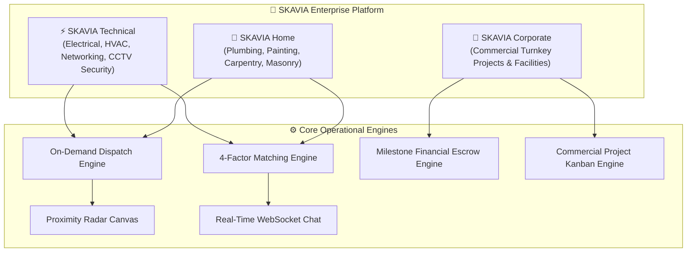

# SKAVIA — Product Specification & Operational Mechanics

  

  <strong>Comprehensive Product Manual: Operational Workflows, Core Algorithms, Escrow & Dispatch Mechanics</strong> 
  <em>Production Standard • The Unified SKAVIA Platform</em>

---

## 📑 1. Platform Overview & Service Structure

**SKAVIA** is an on-demand service and skilled trade workforce platform. Instead of functioning as an unmoderated third-party directory, **SKAVIA operates as one unified and accountable platform**. We guarantee the quality, safety, and delivery of every service through three specialized divisions:

1. **SKAVIA Technical (`TECH`):** Electrical installations, AC servicing and inverter repairs, industrial wiring, CCTV security systems, and office networking.
2. **SKAVIA Home (`HOME`):** Sanitary plumbing, leak repairs, interior and exterior wall painting, waterproofing, and woodwork/carpentry.
3. **SKAVIA Corporate (`CORP`):** End-to-end commercial turnkey fit-outs, corporate renovations, multi-trade specialist assemblies, and facility management contracts.

---

## 🧠 2. Core Algorithms & Systems Used in SKAVIA

SKAVIA uses proven software engineering and computer science algorithms to power candidate matching, geographic calculations, fraud prevention, and offline resilience:

### 2.1 Multi-Factor Candidate Recommendation Algorithm
* **Purpose:** Evaluates, ranks, and recommends the best specialists when a customer posts a job requirement.
* **How It Works:** Rather than showing random workers, candidates are ranked based on four balanced factors:
  1. **Skill Tag Match (40% Weight):** Checks the overlap between required job skills and the technician's verified skills.
  2. **Geographic Proximity (25% Weight):** Prioritizes technicians located closest to the customer's neighborhood or zone.
  3. **Reputation & Past Track Record (20% Weight):** Combines average star ratings with experience and total completed jobs.
  4. **Budget Alignment (15% Weight):** Evaluates how closely the technician's hourly rate fits within the customer's budget.
* **Implementation:** `matching_scoring_engine.dart` and `CandidateMatchesScreen`.

---

### 2.2 Haversine Geodetic Distance Algorithm
* **Purpose:** Calculates the exact real-world distance in kilometers between two GPS coordinates on Earth.
* **Why It Is Used:** Enables fast on-device distance calculation and filtering without paying for high-cost external map API calls.
* **Implementation:** `LocationService` and proximity radar radius filters.

---

### 2.3 Cryptographic 4-Digit Handshake OTP Verification
* **Purpose:** Guarantees that a technician physically visited the customer's location and completed the job before money is released from escrow.
* **How It Works:**
  1. When a booking is confirmed, a random 4-digit code is generated and displayed exclusively on the customer's phone.
  2. Upon completing the physical work, the customer shares the code with the technician.
  3. The technician submits the code in their app, which performs a server-side check.
  4. Once verified, the booking is marked complete and payment is credited to the technician's balance.
* **Implementation:** `JobOtpBannerCard` and `ActiveJobScreen`.

---

### 2.4 Idempotent Atomic Settlement Algorithm
* **Purpose:** Guarantees financial safety, zero duplicate charges, and automatic 85/15 revenue splitting.
* **How It Works:**
  1. Uses database transaction locking (`FOR UPDATE`) to prevent concurrent duplicate checkouts.
  2. Checks the unique payment transaction ID (`transaction_id`). If already processed, it safely returns the existing receipt.
  3. Executes an all-or-nothing database transaction: updates booking status, splits 85% to worker earnings, keeps 15% platform fee, and creates a formal digital invoice.
* **Implementation:** `complete_payment_transaction` database stored procedure.

---

### 2.5 Radar Sweep Polar Projection
* **Purpose:** Displays an interactive, rotating circular radar screen showing nearby technicians in the area.
* **How It Works:** Converts geographic distance and bearing angle into screen pixel coordinates, smoothly brightening icons as the rotating radar line passes over them.
* **Implementation:** `RadarMapCanvas` and `RadarMapSheet`.

---

### 2.6 Priority-Based Task Scheduling (Turnkey Projects)
* **Purpose:** Organizes commercial project workflows into logical steps and sequential deliverables.
* **How It Works:** Tasks are structured across priority levels (Critical, High, Medium, Low) and dependency chains on a Kanban board, ensuring prerequisite work is approved before downstream tasks begin.
* **Implementation:** `TaskBoardScreen` and `project_controller.dart`.

---

### 2.7 Exponential Backoff Offline Sync Algorithm
* **Purpose:** Guarantees zero data loss during network dropouts or offline usage.
* **How It Works:**
  1. Offline actions (such as saving addresses or drafting bookings) are queued in local storage with an RFC 4122 v4 UUID key.
  2. When connectivity returns, items are processed in FIFO order.
  3. If an upload fails due to server timeout, the app waits with doubling intervals (1s, 2s, 4s, 8s) before retrying to prevent network congestion.
* **Implementation:** `offline_sync_queue_manager.dart` and `offline_sync_banner.dart`.

---

### 2.8 Dynamic Profile Completion Intelligence
* **Purpose:** Guides users to complete essential profile details progressively without forcing long forms during signup.
* **How It Works:**
  - Evaluates profile completeness across key attributes:
    * Full Name: 15%
    * Email Address: 15%
    * Phone Number: 10%
    * Profile Photo: 10%
    * Saved Service Address: 20%
    * Date of Birth: 15%
    * Emergency Contact: 15%
  - Displays a real-time progress bar and recommends the single highest-impact missing detail with a direct shortcut button.
* **Implementation:** `profile_completion_engine.dart` and `profile_completion_banner_card.dart`.
* **Milestone Grouping:** Tasks are grouped by sequential project milestones to ensure orderly execution.

---

## ⚙️ 3. Core Operational Features

### 3.1 Standardized Service Catalog & Fixed SKU Pricing
* **Clear Fixed Rates:** Everyday repair services (e.g., Inverter AC Servicing, Water Pump Repair) have fixed, transparent pricing in BDT.
* **No Hidden Fees:** Customers see an itemized breakdown (Service Price + Platform Fee + VAT) before they pay.

### 3.2 Turnkey Commercial Projects & Milestone Escrow
* **Milestone Escrow:** Large contracts are divided into clear deliverables in `project_milestones`. Funds for each milestone are deposited into escrow and released only after customer approval.
* **Multi-Trade Specialist Teams:** Businesses can assemble cross-functional teams (e.g. Lead Electrician, Plumber, IT Network Engineer) via `TeamRosterScreen`.
* **Kanban Task Board:** Deliverables are managed through `Todo`, `In Progress`, and `Done` states in `TaskBoardScreen`.

### 3.3 Shift Management & Availability Scheduler
* **Weekly Schedule Grid:** Specialists can set their working days and hourly shifts in `AvailabilityCalendarScreen`.
* **Dispatch Routing:** Incoming dispatch requests are only sent to specialists who are currently on shift.

### 3.4 Multi-Rail Financial Settlement
* **Local Payment Options:** Full support for bKash, Nagad, Visa, Mastercard, and American Express.
* **Instant Digital Invoices:** Downloadable VAT-compliant receipts with official tax numbers and itemized costs.

---

## 📋 4. System Workflow Matrix

| Feature Area | How It Works | UI Screen & Widgets | Backing Database Entity |
| :--- | :--- | :--- | :--- |
| **Catalog Services** | Fixed price SKUs, branch filter, one-tap booking | `CategoryCatalogScreen`, `CatalogFilterPill` | `categories`, `services` |
| **Shift Management** | Weekly working hours grid, toggle shifts | `AvailabilityCalendarScreen`, `WorkerWeeklyScheduleSelector` | `worker_profiles.availability` |
| **Turnkey Projects** | Milestone contracts, multi-specialist teams | `ProjectDashboardScreen`, `TeamRosterScreen` | `projects`, `project_milestones` |
| **Task Management** | Interactive Kanban board with drag-and-drop | `TaskBoardScreen`, `ProjectTaskItemCard` | `tasks` |
| **Real-Time Chat** | Fast WebSocket messaging with read receipts | `ChatRoomScreen`, `ChatMessageBubble` | `conversations`, `messages` |
| **Payment Settlement**| Atomic stored procedure, anti-duplicate check | `complete_payment_transaction` RPC, `InvoiceScreen` | `payments`, `worker_earnings` |
| **Local MFS Payments**| bKash and Nagad direct checkout | `BookingPaymentMethodList`, `SimulatedCheckoutScreen` | `payments.payment_method` |
| **Proximity Radar** | Custom-drawn circular radar sweep | `RadarMapCanvas`, `RadarMapSheet` | `service_request_coordinates` |
| **AI Assistant** | Natural language job breakdown and estimation | `SkaviaAiScreen`, `AiChatView` | `app_configurations` |
| **User Identity** | Dual SMS OTP login, customer vs worker profiles | `PhoneLoginForm`, `RoleSelectionScreen` | `users`, `customer_profiles` |
| **Progressive Profile** | Role-weighted completion scoring & missing fields | `UnifiedProfileView`, `EditDetailedProfileScreen` | `users`, `user_addresses` |
| **Feature Eligibility** | Just-in-time gating before checkout or job acceptance | `FeatureGateDialog`, `BookingConfirmationScreen` | `users.account_status`, `user_addresses` |
| **Offline Resilience** | 5-state connectivity monitor, persistent queue | `OfflineSyncBanner`, `OfflineSyncQueueManager` | `offline_sync_queue`, LocalCache |
| **Notification Center** | Deduplicated alerts, birthday gifts, category filters | `NotificationCenterScreen`, `NotificationBadge` | `user_notifications` |

---

## 🛡️ 5. User Lifecycle, Progressive Profile & Resilience Architecture

### 5.1 Registration Invariant & Progressive Onboarding
To maintain maximum conversion rates and avoid user abandonment, SKAVIA enforces a strict architectural invariant:
* **Frictionless Signup:** Account creation requires only 4 baseline attributes: Full Name, Email, Phone Number, and Password.
* **Separation of Concerns:** Account Creation is strictly separated from Identity Verification, Profile Completion, and Feature Eligibility.
* **Progressive Data Collection:** Additional details (such as Service Address, Date of Birth, Emergency Contact, and Role Attributes) are requested progressively when relevant or through the Profile Hub.

### 5.2 Dynamic Profile Completion Scoring
Profile completeness is calculated dynamically via client-side intelligence (`ProfileCompletionEngine`) and database stored procedure (`calculate_profile_completion`):

#### Weight Breakdown for Individual Customers:
| Attribute | Percentage | Required Condition | Navigation Target |
| :--- | :--- | :--- | :--- |
| **Full Name** | 15% | 2 or more characters | `editDetailedProfile` |
| **Verified Email** | 15% | Standard RFC 5322 format | `editDetailedProfile` |
| **Phone Number** | 10% | Valid phone number | `editDetailedProfile` |
| **Profile Photo** | 10% | Valid image URI or uploaded avatar | `editDetailedProfile` |
| **Saved Service Address** | 20% | At least 1 registered default address | `savedAddresses` |
| **Date of Birth** | 15% | Valid historical calendar date | `editDetailedProfile` |
| **Emergency Contact** | 15% | Contact Name + Valid Phone | `editDetailedProfile` |
| **Total** | **100%** | Comprehensive User Identity | — |

The profile score dynamically updates in real-time, displays an encouraging progress indicator, and generates a prioritized call-to-action recommending the single highest-impact missing attribute.

---

### 5.3 Centralized Feature Eligibility Engine
Instead of blocking users globally, SKAVIA uses a Just-In-Time (JIT) eligibility gate (`FeatureEligibilityService`):
1. **Service Booking Gate (`bookService`):**
   * Pre-requisites: Active account status (`account_status != 'suspended'`) and at least 1 saved service address.
   * UX: If no address is saved when clicking "Confirm Booking", a modal bottom sheet (`FeatureGateDialog`) gracefully prompts the user to add an address immediately, returning straight to checkout.
2. **Specialist Job Acceptance Gate (`acceptJob`):**
   * Pre-requisites: Active account status, verified profile status (`verified == true`), and at least 1 verified trade skill.
3. **Payout Request Gate (`requestPayout`):**
   * Pre-requisites: Active account status and registered payout method (bKash/Nagad/Bank).
4. **Corporate Project Posting Gate (`postTurnkeyProject`):**
   * Pre-requisites: Active account status and verified corporate profile details.

---

### 5.4 Offline-First Resilience & Sync Queue Architecture
SKAVIA delivers a smooth user experience across unpredictable network conditions (e.g. cellular handoffs, rural zones, underground basements):
* **5-State Connectivity Engine (`NetworkConnectivityService`):**
  Monitors physical connectivity and latency, classifying state as `online`, `poorNetwork`, `offline`, `syncing`, or `syncFailed`.
* **Real-Time Visual Banner (`OfflineSyncBanner`):**
  Subtly alerts users at the top of the interface during offline or poor network states, turning amber for offline and indigo during background synchronization.
* **In-Memory & Persistent Cache (`LocalCacheService`):**
  Fast local reads with configurable Time-To-Live (TTL) expiration, preventing empty screen flashes.
* **Persistent Sync Queue (`OfflineSyncQueueManager`):**
  When operations are performed offline (such as drafting bookings or updating addresses), they are placed in a persistent FIFO queue. Each payload carries an RFC 4122 v4 UUID `idempotencyKey`.
* **Exponential Backoff:**
  Failed network requests retry with doubling delay intervals (1 second, 2 seconds, 4 seconds, 8 seconds). After 5 unsuccessful attempts, items are tagged as `failed` for manual user retry without losing captured data.

---

### 5.5 In-App Notification Center & Deduplication Rules
* **Multi-Category Feeds:** Notifications are classified into `urgent`, `booking`, `birthday`, `profile`, `security`, and `general`.
* **Zero-Spam Deduplication:** Notifications are indexed with unique `dedup_key` values (e.g. `birthday_promo_20261110`). Identical notifications within the same active cycle are silently rejected.
* **Automated Birthday Celebration:** When a user's date of birth matches the current calendar day and `birthday_notifications_enabled` is true, SKAVIA automatically issues a birthday greeting with an exclusive voucher discount.
* **Account Deactivation & Grace Period:**
  Users can request account deactivation or deletion in `PrivacySecurityScreen`. To prevent accidental loss of service history, deletion initiates a 30-day grace period during which the account remains `deactivated` and can be restored upon re-login before permanent scrubbing.
