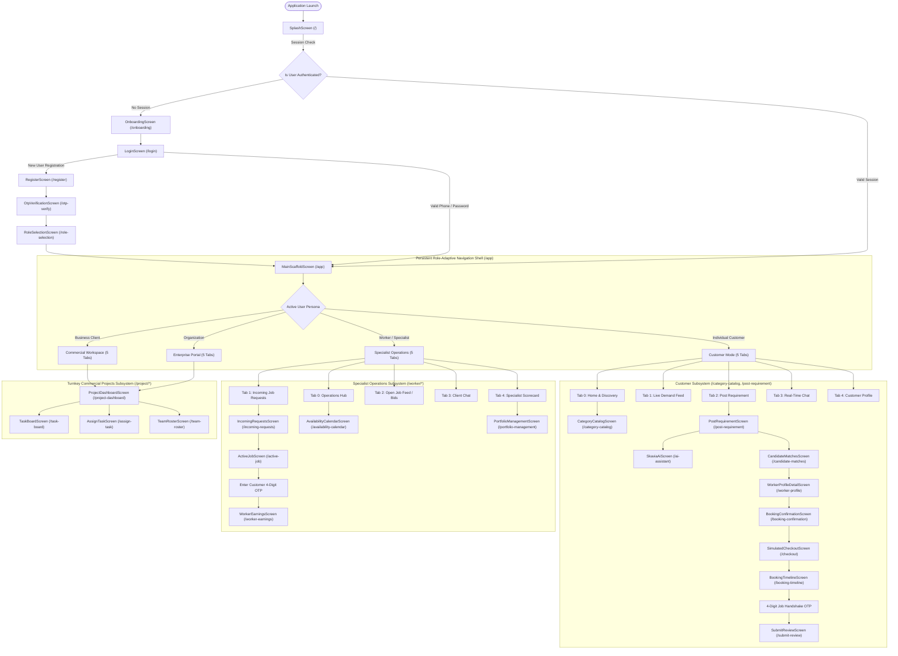
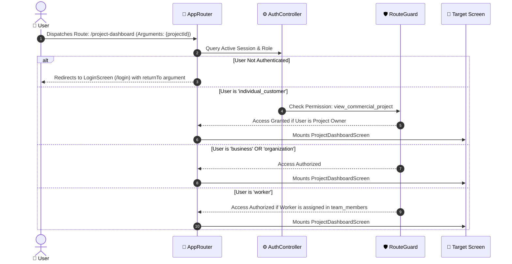
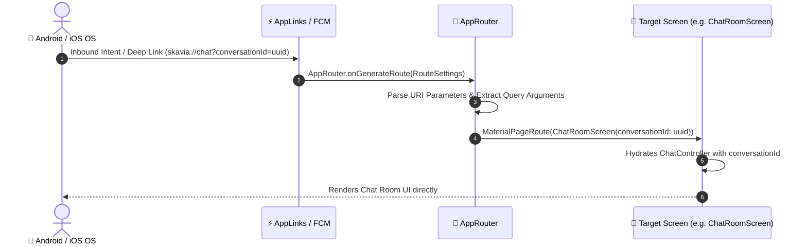

# SKAVIA — System Routing, Navigation Architecture & RBAC

  

  <strong>Declarative Named Route Dispatch, Dynamic Role-Adaptive Shell & Deep Linking Specification</strong> 
  <em>Flutter 3.38+ • Dart 3.10+ • Single-Enterprise Multi-Role Control</em>

---

## 📑 1. Master System Navigation Topology

The navigation graph of **SKAVIA** coordinates the end-to-end user lifecycle across all four active user roles (**Individual Customer**, **Business Client**, **Organization**, and **Worker / Specialist**):

---

## 🛡️ 2. Dynamic RBAC Navigation Interceptor Pipeline

Every route dispatch through `AppRouter.onGenerateRoute()` is verified against the authenticated user's permissions:

---

## 🔗 3. Deep Linking & Notification Launch Sequence

---

## 📋 4. Master Route Inventory & Arguments Specification

| Route Constant | Named Route Path | Target Screen File | Allowed Roles | Argument Payload Structure |
| :--- | :--- | :--- | :--- | :--- |
| `AppRoutes.splash` | `/` | `SplashScreen` | Public | None |
| `AppRoutes.onboarding` | `/onboarding` | `OnboardingScreen` | Public | None |
| `AppRoutes.login` | `/login` | `LoginScreen` | Public | None |
| `AppRoutes.register` | `/register` | `RegisterScreen` | Public | None |
| `AppRoutes.roleSelection`| `/role-selection` | `RoleSelectionScreen` | Authenticated | None |
| `AppRoutes.otpVerify` | `/otp-verify` | `OtpVerificationScreen` | Public | `{'phoneNumber': String, 'fullName': String?, 'verificationId': String?}` |
| `AppRoutes.appShell` | `/app` | `MainScaffoldScreen` | Authenticated | None |
| `AppRoutes.categoryCatalog`| `/category-catalog` | `CategoryCatalogScreen` | Public / All | `{'categoryId': String?, 'searchQuery': String?}` |
| `AppRoutes.postRequirement`| `/post-requirement` | `PostRequirementScreen` | Customer, Biz, Org | `{'categoryId': String?}` |
| `AppRoutes.candidateMatches`| `/candidate-matches`| `CandidateMatchesScreen` | Customer, Biz, Org | `{'requirementId': String, 'requirementTitle': String, 'budget': double}` |
| `AppRoutes.workerProfile`| `/worker-profile` | `WorkerProfileDetailScreen`| All Roles | `{'name': String, 'title': String, 'rating': double, 'hourlyRate': String}` |
| `AppRoutes.bookingConfirmation`| `/booking-confirmation`| `BookingConfirmationScreen`| Customer, Biz, Org| `{'workerProfileId': String, 'workerName': String, 'hourlyRate': double}` |
| `AppRoutes.checkout` | `/checkout` | `SimulatedCheckoutScreen` | Customer, Biz, Org| `{'title': String, 'amount': double, 'serviceRequestId': String?}` |
| `AppRoutes.invoice` | `/invoice` | `InvoiceScreen` | Authenticated | `{'invoiceNumber': String, 'amount': double, 'paidAt': DateTime}` |
| `AppRoutes.paymentSuccess`| `/payment-success` | `PaymentSuccessScreen` | Authenticated | `{'amount': double, 'transactionId': String, 'jobTitle': String}` |
| `AppRoutes.incomingRequests`| `/incoming-requests`| `IncomingRequestsScreen` | Worker | None |
| `AppRoutes.activeJob` | `/active-job` | `ActiveJobScreen` | Worker | None |
| `AppRoutes.workerEarnings`| `/worker-earnings` | `WorkerEarningsScreen` | Worker | None |
| `AppRoutes.availabilityCalendar`| `/availability-calendar`| `AvailabilityCalendarScreen`| Worker | None |
| `AppRoutes.portfolioManagement`| `/portfolio-management`| `PortfolioManagementScreen`| Worker | None |
| `AppRoutes.projectDashboard`| `/project-dashboard`| `ProjectDashboardScreen`| Biz, Org, Worker | `{'projectId': String, 'projectTitle': String}` |
| `AppRoutes.taskBoard` | `/task-board` | `TaskBoardScreen` | Biz, Org, Worker | `{'projectId': String, 'projectTitle': String}` |
| `AppRoutes.assignTask` | `/assign-task` | `AssignTaskScreen` | Biz, Org | `{'projectId': String}` |
| `AppRoutes.teamRoster` | `/team-roster` | `TeamRosterScreen` | Biz, Org, Worker | `{'projectId': String}` |
| `AppRoutes.chatList` | `/chat-list` | `ChatListScreen` | Authenticated | None |
| `AppRoutes.chatRoom` | `/chat-room` | `ChatRoomScreen` | Authenticated | `{'conversationId': String, 'otherParticipantName': String}` |
| `AppRoutes.submitReview` | `/submit-review` | `SubmitReviewScreen` | Customer, Biz, Org| `{'workerProfileId': String, 'serviceRequestId': String?}` |
| `AppRoutes.workerReputation`| `/worker-reputation`| `WorkerReputationScreen` | Authenticated | `{'workerProfileId': String, 'workerName': String}` |
| `AppRoutes.skaviaAi` | `/ai-assistant` | `SkaviaAiScreen` | All Roles | `{'initialPrompt': String?}` |
| `AppRoutes.liveJobFeed` | `/live-job-feed` | `LiveJobFeedScreen` | All Roles | None |
| `AppRoutes.adminDashboard`| `/admin-dashboard` | `AdminDashboardScreen` | Admin / Internal | None (Governance Hub) |
