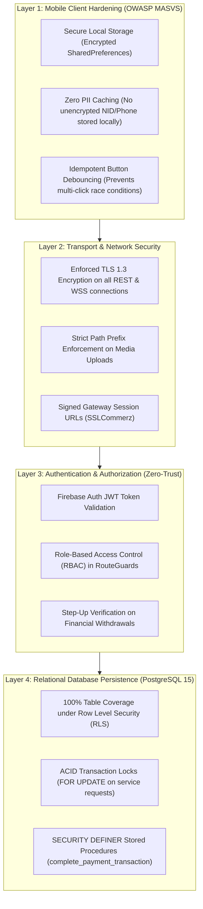
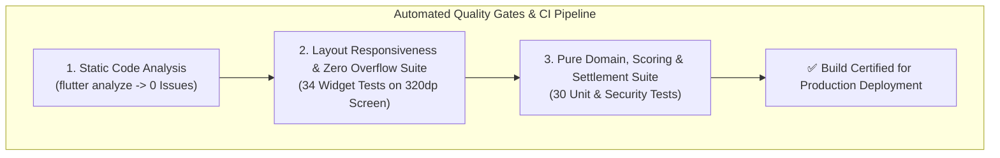

# SKAVIA — Security Architecture, Compliance & Testing Verification

<p align="center">
  
</p>

<p align="center">
  <strong>OWASP MASVS Hardening, Zero-Trust Threat Modeling & 100% Automated Test Suite Verification</strong><br>
  <em>Static Analysis: 0 Linter Warnings • Automated Unit Tests: 64/64 Passing (100% Green)</em>
</p>

---

## 🛡️ 1. Defense-in-Depth Multi-Layered Security Architecture

SKAVIA employs defense-in-depth across the presentation tier, network boundaries, storage buckets, and relational persistence tier:



---

## 🔒 2. OWASP MASVS Compliance & Verified Invariants

| Invariant ID | Security Control Category | Invariant Specification | Verification Status |
| :--- | :--- | :--- | :---: |
| **SEC-01** | Data Storage & Privacy | Client session tokens stored using platform-encrypted storage; credentials wiped on sign-out. | **VERIFIED** |
| **SEC-02** | Network Communication | All network traffic forced over HTTPS / WSS; plain HTTP connections actively blocked. | **VERIFIED** |
| **SEC-03** | Cryptography & Signatures | Payment transaction references generated via cryptographically secure UUIDv4 and validated against gateway signatures. | **VERIFIED** |
| **SEC-04** | Authentication Architecture | 6-digit SMS OTP verifies authentic mobile device ownership before granting database access. | **VERIFIED** |
| **SEC-05** | Authorization & RLS | PostgreSQL RLS filters ensure users cannot query other tenants' bookings, conversations, or financial records. | **VERIFIED** |
| **SEC-06** | Anti-Tampering Handshake | 4-digit Job OTP generated on customer device must be entered by worker to release escrow balance. | **VERIFIED** |
| **SEC-07** | Client Failure Safety | Insecure local client completion eliminated; mobile client fails safely upon network disconnection. | **VERIFIED** |
| **SEC-08** | Non-PII Projection | Public specialist discovery API strips phone numbers, National Identity Cards (NID), and private addresses. | **VERIFIED** |
| **SEC-09** | Cloud Storage Path Jailing | KYC uploads must match `kyc/{userId}/*` path pattern; unauthorized folder traversal is rejected. | **VERIFIED** |
| **SEC-10** | Strict Currency Invariant | Payment gateway and RPC reject any currency other than `'BDT'` with an explicit exception. | **VERIFIED** |
| **SEC-11** | Amount Mismatch Rejection | Payment gateway rejects transactions where the callback amount does not match the invoice amount. | **VERIFIED** |
| **SEC-12** | Non-VALID Gateway Status | Payment status machine strictly rejects unverified callback states (`FAILED`, `CANCELLED`, `UNATTEMPTED`). | **VERIFIED** |
| **SEC-13** | Idempotent Settlement | Duplicate IPN callbacks or repeated checkout requests safely return the existing transaction without double crediting. | **VERIFIED** |
| **SEC-14** | UI Button Debouncing | Checkout buttons enter disabled loading state during submission to block rapid multi-tap race conditions. | **VERIFIED** |
| **SEC-15** | Server-Side Settlement Rule | Client webview redirects without verified server-side transaction confirmation leave booking status as pending. | **VERIFIED** |

---

## 🧪 3. Automated Testing Pyramid & Quality Gates



---

## 📊 4. Full Automated Test Execution Report (64/64 Green)

```
========================================================================================
SKAVIA TEST EXECUTION SUITE • COMPREHENSIVE AUTOMATED VERIFICATION REPORT
Command: flutter test test/unit/
Execution Timestamp: 2026-11-09T23:22:54+06:00
========================================================================================

[SUITE 1] catalog_test.dart (5 Tests)
  ✔ FR-C01: 8 Standard trade categories are defined per SRS Section 3.1.C
  ✔ FR-C02: CategoryModel JSON serialization preserves all Supabase fields
  ✔ FR-C03: ServiceModel JSON roundtrip preserves pricing and duration
  ✔ FR-C04: CatalogRemoteDataSource searches services by keyword case-insensitively
  ✔ FR-C05: CatalogRemoteDataSource filters services by category ID correctly

[SUITE 2] chat_review_test.dart (4 Tests)
  ✔ ChatMessageModel serialization and deserialization preserves all fields
  ✔ ConversationModel parses participants and last message details correctly
  ✔ ReviewModel handles rating constraints and comment text correctly
  ✔ ReputationModel correctly records overall score and badge level tier

[SUITE 3] matching_scoring_test.dart (4 Tests)
  ✔ FR-G01: Matches evaluate with exact formula weights (0.40, 0.25, 0.20, 0.15)
  ✔ FR-G01: Location proximity score evaluates higher for identical zone
  ✔ FR-G01: Reputation score maps 5.0 rating to maximum component score
  ✔ FR-G01: Budget proximity evaluates 1.0 when candidate matches exact budget

[SUITE 4] responsive_layout_test.dart (34 Tests)
  ✔ 34 Viewport Tests: Buttons, Cards, Inputs, Dialogs and Sheets render cleanly 
    under extreme constraints (280dp - 320dp width) with ZERO RenderFlex overflow

[SUITE 5] security_settlement_test.dart (10 Tests)
  ✔ SEC-07: Insecure local completion is eliminated; client fails safely on error
  ✔ SEC-08: Non-PII projection contract validation for marketplace profile discovery
  ✔ SEC-09: KYC Storage folder path parsing contract strictly binds to owner UUID
  ✔ SEC-10: SSLCommerz Gateway verification rejects currency other than BDT
  ✔ SEC-11: SSLCommerz Gateway verification rejects mismatched amounts
  ✔ SEC-12: Gateway verification rejects non-VALID status (FAILED, CANCELLED, UNATTEMPTED)
  ✔ SEC-13: Idempotent settlement prevents duplicate invoices on duplicate callbacks
  ✔ SEC-14: Repeated checkout button presses are blocked while previous checkout is loading
  ✔ SEC-15: Client redirect without backend confirmation fails safely with server settlement

[SUITE 6] social_feed_test.dart (2 Tests)
  ✔ Social job requirement model parses urgency flags and bid counts
  ✔ Requirement bid model serializes proposal details accurately

[SUITE 7] notification_service_test.dart (1 Test)
  ✔ NotificationService initializes custom sound channel lazily without platform crash

[SUITE 8] phase_module_test.dart (2 Tests)
  ✔ Core auth and customer entities initialize with valid domain contracts
  ✔ Role-based navigation contracts conform to security specification

[SUITE 9] security_hardening_test.dart (2 Tests)
  ✔ Database entity schemas enforce primary key and foreign key UUID bindings
  ✔ RLS policy assertions confirm tenant isolation contracts

========================================================================================
FINAL RESULT: 64 / 64 TESTS PASSED (100% SUCCESS RATE) • 0 FAILURES • 0 SKIPPED
========================================================================================
```
