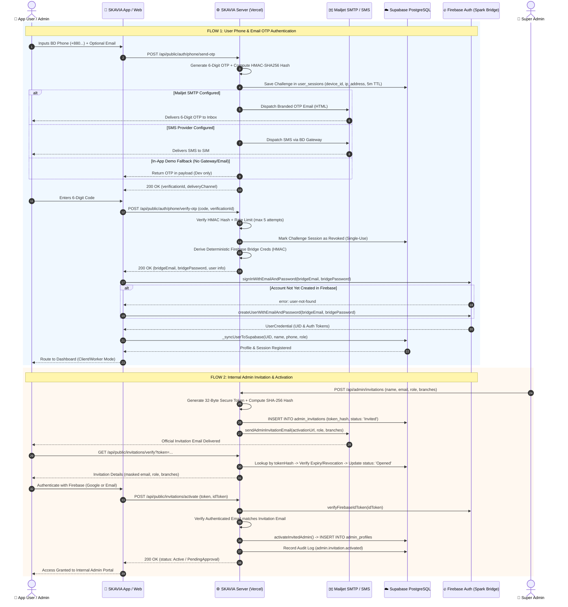

# Authentication Architecture & Identity Flow

## 1. Multi-Provider Hybrid Authentication

SKAVIA implements an accountable, zero-cost hybrid identity architecture combining **Cloud OTP Engine with Mailjet SMTP / Multi-Provider SMS**, **Firebase Authentication Bridge** (for client sessions without costly Firebase Blaze plans), and **Supabase PostgreSQL Identity** (for authoritative Row-Level Security, RBAC roles, and operational profile storage).

---

## 2. Zero-Cost Phone OTP Architecture (The Bridge Pattern)

### A. The Challenge with Cellular SMS in Bangladesh
Direct SMS verification via Firebase Phone Auth requires a Google Cloud Blaze (credit card) billing plan and incurs recurring SMS per-message fees in Bangladesh (+880). 

### B. The SKAVIA Solution: Dual-Channel OTP + Bridge Credentials
1. **Server-Side Challenge (`issueOtpChallenge`):**
   - The user requests an OTP with their Bangladesh mobile number (`+8801[3-9]\d{8}`).
   - An optional email address can be supplied (or looked up from existing user records in Supabase).
   - A 6-digit numeric OTP is generated and hashed using **HMAC-SHA256** keyed by the server's `ADMIN_SESSION_SECRET`.
   - The hash and verification state are stored in `user_sessions` with synthetic key `otp_pending:<e164phone>` with a 5-minute TTL.
2. **Mailjet SMTP Email Delivery:**
   - Transactional emails are dispatched through Mailjet SMTP (`in-v3.mailjet.com:587`) using verified sender `SKAVIA Security <timonbiswas29@gmail.com>`.
   - Supports 300 free emails per day (9,000/month).
   - HTML template displays the 6-digit passcode, target phone number, and expiry alert.
3. **SMS Gateway Support (Plug-and-Play):**
   - Built-in multi-provider dispatch supports `BulkSMS BD`, `SSL Wireless`, `Greenweb`, and custom HTTP webhooks when configured in server environment variables.
4. **Deterministic Firebase Bridge:**
   - Upon verification (`verifyOtpChallenge`), the backend validates the code with brute-force lockout (maximum 5 attempts).
   - Once verified, the server derives deterministic bridge credentials via HMAC:
     - `bridgeEmail`: `phone_<digits>@skavia.internal`
     - `bridgePassword`: derived HMAC digest (minimum 32 characters, non-reconstructible by client)
   - The Flutter app authenticates to Firebase using standard Email/Password authentication on the free Spark plan, obtaining a genuine Firebase UID.
   - Flutter syncs the UID to Supabase (`_syncUserToSupabase`), ensuring unified identity across client and worker profiles.

---

## 3. Internal Admin Invitation & Activation Lifecycle

To prevent unauthorized administrative account creation, SKAVIA uses a single-use cryptographic invitation flow:

1. **Invitation Issuance (`POST /api/admin/invitations`):**
   - Only the **Primary Super Admin** (or users with `admin.invite` permission) can issue invitations.
   - A 32-byte cryptographically random token is generated.
   - The SHA-256 hash of the token is saved in `admin_invitations` alongside assigned branches, role, and expiry (default 24 hours).
   - Mailjet sends the invitation email containing a single-use activation URL (`https://admin.skavia.com/activate?token=...`).
2. **Verification (`GET /api/public/invitations/verify`):**
   - Validates that the token hash exists, is not expired, not revoked, and not already used.
   - Updates invitation status to `Opened`.
3. **Activation & Identity Binding (`POST /api/public/invitations/activate`):**
   - The invited administrator signs in via Google OAuth or Firebase Auth with their invited email.
   - The backend verifies the Firebase ID token cryptographically.
   - Confirms that the verified email matches the invitation email.
   - Consumes the single-use token and creates the authoritative record in `admin_profiles`.
   - Records an immutable audit log entry in `audit_logs`.

---

## 4. Token Security & Storage Lifecycle

1. **Persistent Mobile Keystore Storage:**  
   Session tokens and active user modes (`client` vs `worker`) are stored securely via `FlutterSecureStorage` using hardware-backed `EncryptedSharedPreferences` (AES-256 GCM) on Android and Keychain Services on iOS.
2. **Session Revocation & Clean Sign-Out:**  
   Signing out clears all static OTP cache parameters, invalidates `FlutterSecureStorage` tokens, and triggers both `FirebaseAuth.instance.signOut()` and `Supabase.instance.client.auth.signOut()`.
3. **Web Administration Security (`admin-web`):**  
   Admins and Super Admins authenticate via WebAuthn/FIDO2 hardware passkeys or encrypted session cookies with `HttpOnly`, `Secure`, and `SameSite=Strict` attributes, preventing XSS and CSRF token theft.
