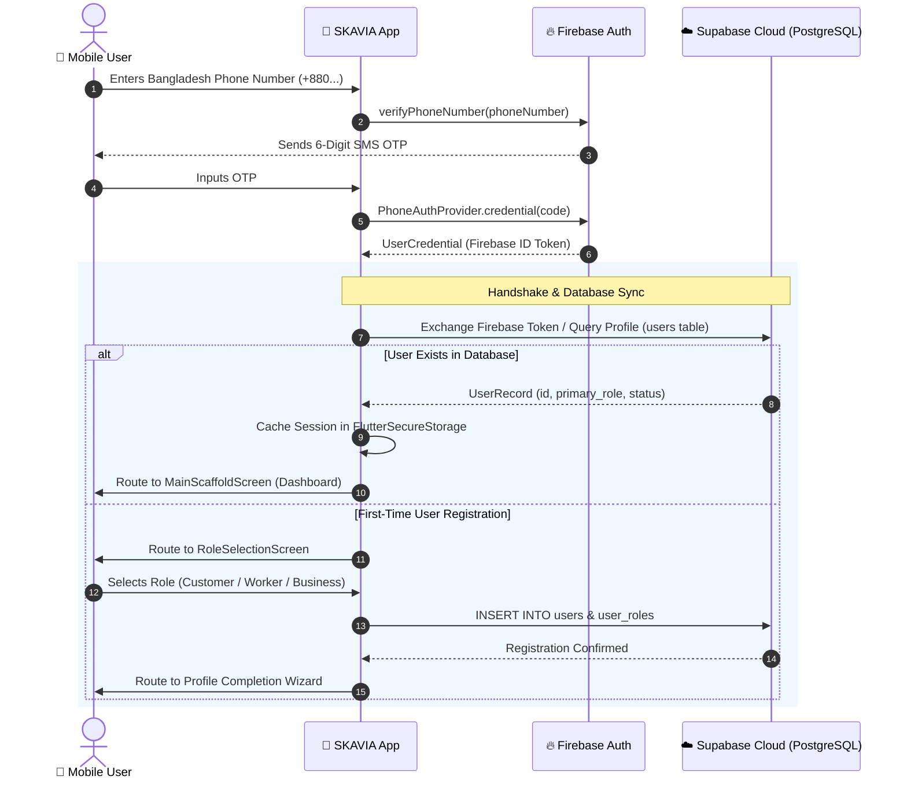

# Authentication Architecture & Identity Flow

## 1. Multi-Provider Hybrid Authentication

SKAVIA implements a secure, hybrid identity architecture combining **Firebase Authentication** (for frictionless cellular SMS OTP and Google Sign-In) with **Supabase PostgreSQL Identity** (for authoritative Row-Level Security, user roles, and profile storage).

---

## 2. Token Security & Storage Lifecycle

1. **Persistent Android Keystore Storage:**  
   Authentication session tokens, refresh tokens, and active user roles are stored securely via `FlutterSecureStorage` using Android's hardware-backed `EncryptedSharedPreferences` and AES-256 GCM encryption.
2. **Session Revocation & Sign-Out:**  
   Signing out invalidates local secure storage keys, clears cached user profiles from `shared_preferences`, and triggers `FirebaseAuth.instance.signOut()` to ensure clean session teardown.
3. **Web Administration Security (`admin-web`):**  
   Admins and Super Admins authenticate via WebAuthn/FIDO2 hardware passkeys or encrypted session cookies with HttpOnly, Secure, and SameSite=Strict attributes, preventing cross-site scripting (XSS) and token theft.
