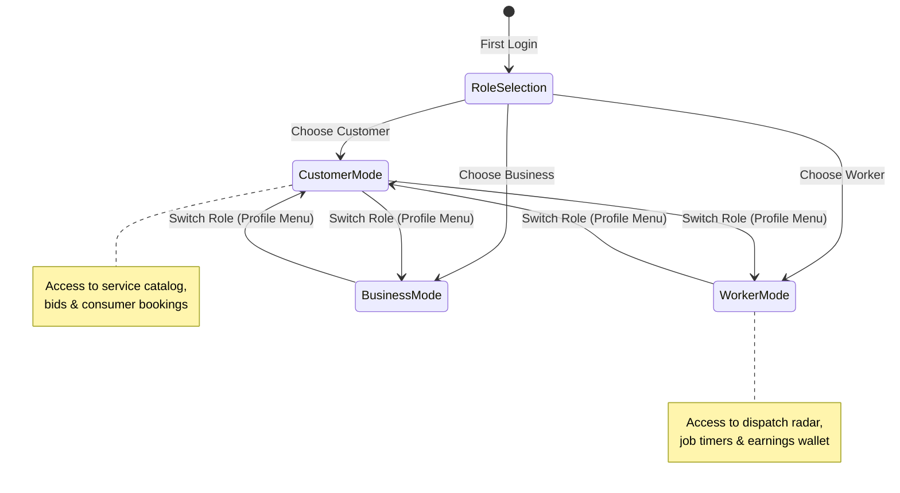

# Authorization & Role-Based Access Control (RBAC)

## 1. Supported User Roles

SKAVIA supports four core user roles across its ecosystem:

| Role Name | Internal Code | Primary Interface | Allowed Capabilities |
| :--- | :--- | :--- | :--- |
| **Customer** | `customer` | Mobile App (`CustomerDashboardView`) | Browse categories, post requirements, accept bids, book on-demand technicians, pay into escrow, issue arrival OTP, and review completed work. |
| **Worker / Specialist** | `worker` | Mobile App (`WorkerDashboardView`) | View nearby dispatch radar, accept jobs, verify arrival OTP, submit completion proof, request payouts, and maintain trade verification. |
| **Business Client** | `business_client` | Mobile App / Client Web | Commission turnkey multi-phase commercial projects, manage teams, fund milestone escrows, and inspect Kanban deliverables. |
| **Administrator** | `admin` / `superadmin` | Admin Web Console (`admin-web/`) | Review KYC verifications, mediate financial disputes, monitor live platform telemetry, manage releases, and administer staff accounts. |

---

## 2. Dynamic Role Mode Switching (`AppRoleMode`)

For users who operate as both a customer (hiring technicians for their home) and a specialist (accepting contract dispatches in their trade), SKAVIA provides seamless in-app role mode switching:

---

## 3. Database Row-Level Security (RLS) Enforcement

Authorization is not merely an app-level UI switch; it is authoritatively enforced at the PostgreSQL database level:
- Customers can only read and update their own bookings (`customer_id = auth.uid()`).
- Workers can only access dispatch records assigned to them or unassigned bids in their trade category.
- Financial transactions, payouts, and escrow allocations require verified server-role or RPC execution with atomic balance checks.
