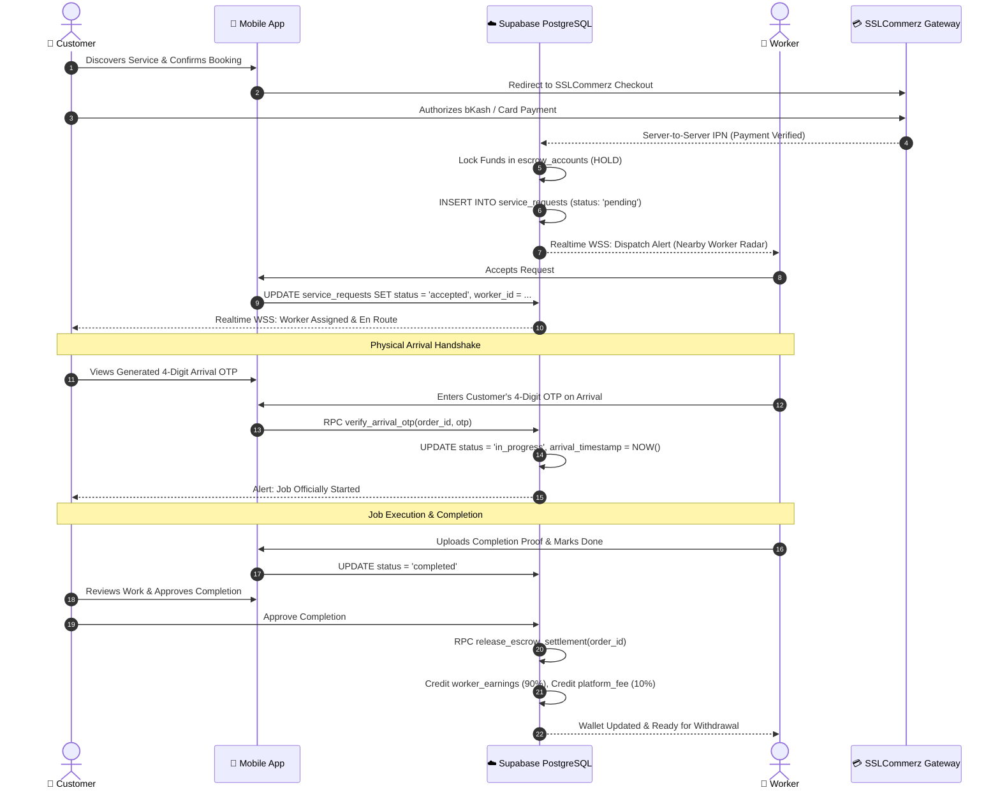

# Data Flow & Lifecycle Management

## 1. End-to-End Service Fulfillment Data Flow

The diagram below traces the end-to-end data lifecycle from order creation through dispatch, arrival handshake, and escrow financial settlement:

---

## 2. Offline Resilience & Sync Queue

For field specialists operating in areas with intermittent cellular connectivity:
1. **Local Action Queuing:** Critical actions (such as status updates or notes) are appended to a persistent local SQLite/Preferences sync queue (`OfflineSyncQueue`).
2. **Network State Monitoring:** The app listens to `connectivity_plus` streams.
3. **Automatic Replay:** Once an active IP connection is restored, pending actions are sequentially replayed with idempotency keys (`dedupKey`), preventing duplicate database writes.
