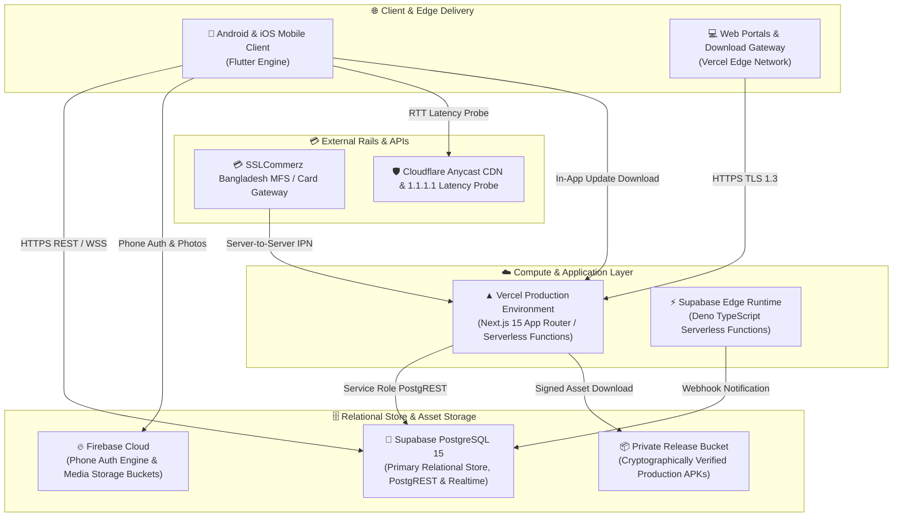

# Cloud Infrastructure & Topology

## 1. Multi-Cloud Topology Overview

The SKAVIA platform leverages a high-availability, multi-cloud infrastructure designed for resilience, security, and low-latency delivery across Bangladesh.

---

## 2. Infrastructure Component Specifications

| Infrastructure Layer | Technology / Service | Location / Region | Responsibility |
| :--- | :--- | :--- | :--- |
| **Relational Database** | PostgreSQL 15 (Supabase Cloud) | AWS ap-southeast-1 (Singapore) | Primary transactional data, RLS enforcement, real-time WebSockets, and ACID ledger. |
| **Media & Auth Cloud** | Google Firebase (`skavia-113a3`) | Google Cloud (asia-south1) | Phone SMS OTP authentication, Google OAuth, and user profile photo storage. |
| **Web & Administration** | Vercel Edge Cloud | Global Anycast Edge (iad1 / sin1) | Next.js 15 web portal, Super Admin console, and public APK download distribution. |
| **Payment Gateway** | SSLCommerz v4 Gateway | Dhaka, Bangladesh | Merchant acquisition, bKash/Nagad/Rocket MFS integration, and credit card processing. |
| **Network & Latency Probe** | Cloudflare Anycast (1.1.1.1) | Dhaka / Regional Edges | Millisecond edge ping measurement in mobile device diagnostics. |
