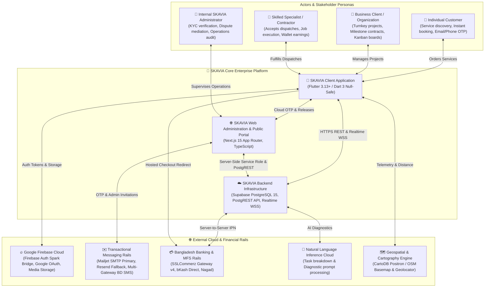

# System Overview & C4 Model

## 1. Executive Summary

**SKAVIA** is an accountable on-demand service and workforce management platform designed to deliver guaranteed, high-accountability service fulfillment across Bangladesh. 

Unlike traditional gig-economy listings or unmonitored directories, SKAVIA enforces:
1. **Physical Arrival Verification:** Cryptographic 4-digit arrival OTP handoff required before any billable timer or job execution begins.
2. **Atomic Escrow Financial Settlement:** Customer funds are locked in escrow upon order confirmation and released to worker earnings only upon digital customer sign-off or resolution.
3. **Multi-Role Single Enterprise Ecosystem:** One unified database architecture serving Individual Customers, Enterprise Business Clients, Skilled Specialists (Workers), and Governance Administrators.
4. **Zero-Cost Production Identity Rails:** Dual-channel OTP challenge engine combining **Mailjet SMTP** with a deterministic **Firebase Auth Spark Bridge** to bypass cellular SMS gating.

---

## 2. C4 Model — Level 1: System Context

---

## 3. Core Subsystems

### A. Mobile Application (`lib/`)
The primary touchpoint for consumers, business clients, and field specialists. Built with Flutter 3 and Dart 3 using feature-first clean architecture:
- Dual-channel Phone/Email OTP sign-in with auto-paste and delivery indicator.
- Google Sign-In with automatic Supabase profile synchronization.
- CartoDB Positron / OpenStreetMap basemaps (zero paid API keys required).
- Responsive UI layouts supporting mobile handsets, foldables, tablets, and desktop viewports.

### B. Admin Web Console (`admin-web/`)
A multi-surface enterprise platform built with Next.js 15 App Router serving:
- **Public Landing & Release Distribution Portal:** Live product downloads, SHA-256 verification manifests, real-time client device detection and 5G/4G architecture recommendation.
- **Identity & Cloud OTP Engine:** HMAC-SHA256 keyed challenge issuance, rate-limiting, and Mailjet SMTP transactional email delivery.
- **Internal Operations Console:** KYC worker verification queue, dispute resolution desk, and transaction auditing.
- **Super Admin Governance:** Role-based access control (RBAC), single-use cryptographic admin invitations, WebAuthn/Passkey registration, session revocation, and cryptographic APK release signing policy.

### C. Backend & Database Tier (`supabase/`)
PostgreSQL 15 managed via Supabase Cloud:
- **Modular Schema Organization:** 8 structured domain DDL files under `supabase/schema/` (`01_identity_and_rbac.sql` to `08_rls_functions_and_indexes.sql`).
- **Strict Row-Level Security (RLS):** Mobile clients access user-scoped records via `auth.uid()::text`. Administrative operations are exclusively handled by server-side `service_role` through authenticated Next.js API endpoints.
- **Atomic Stored Procedures (RPC):** Ensuring all financial ledger debits and credits execute within atomic ACID transactions (`complete_payment_transaction()`).
