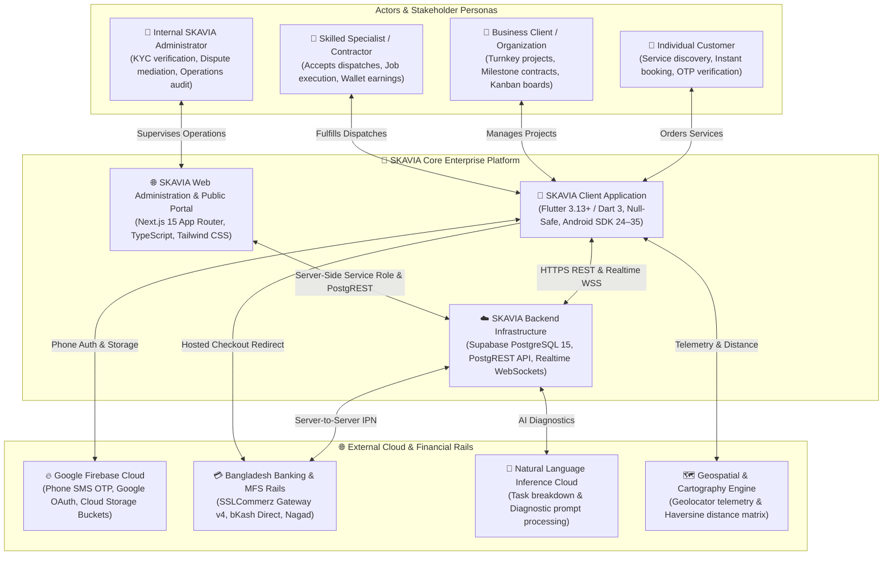

# System Overview & C4 Model

## 1. Executive Summary

**SKAVIA** is an accountable on-demand service and workforce management platform designed to deliver guaranteed, high-accountability service fulfillment across Bangladesh. 

Unlike traditional gig-economy listings or unmonitored directories, SKAVIA enforces:
1. **Physical Arrival Verification:** Cryptographic 4-digit arrival OTP handoff required before any billable timer or job execution begins.
2. **Atomic Escrow Financial Settlement:** Customer funds are locked in escrow upon order confirmation and released to worker earnings only upon digital customer sign-off or resolution.
3. **Multi-Role Single Enterprise Ecosystem:** One unified database architecture serving Individual Customers, Enterprise Business Clients, Skilled Specialists (Workers), and Governance Administrators.

---

## 2. C4 Model — Level 1: System Context

---

## 3. Core Subsystems

### A. Mobile Application (`lib/`)
The primary touchpoint for consumers, business clients, and field specialists. Built with Flutter 3 and Dart 3 using feature-first clean architecture. Runs across modern 5G/4G 64-bit devices (`arm64-v8a`), legacy 32-bit devices (`armeabi-v7a`), and Web/Desktop environments.

### B. Admin Web Console (`admin-web/`)
A multi-surface web platform built with Next.js 15 App Router serving:
- **Public Landing & Release Distribution Portal:** Live product downloads, SHA-256 verification manifests, real-time client device detection and 5G/4G architecture recommendation.
- **Internal Operations Console:** KYC worker verification queue, dispute resolution desk, and transaction auditing.
- **Super Admin Governance:** Role-based access control (RBAC), WebAuthn/Passkey registration, session revocation, and cryptographic APK release signing policy.

### C. Backend & Database Tier (`supabase/`)
PostgreSQL 15 managed via Supabase Cloud:
- **34 Base Schema Tables + 24 Lifecycle Tables:** Managing enterprise branches, users, taxonomies, dispatches, projects, escrow ledgers, and governance logs.
- **Strict Row-Level Security (RLS):** Every table is guarded by declarative PostgreSQL policies.
- **Atomic Stored Procedures (RPC):** Ensuring all financial ledger debits and credits execute within atomic ACID transactions.
