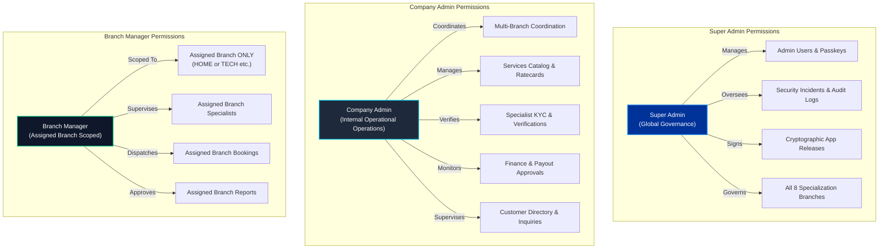
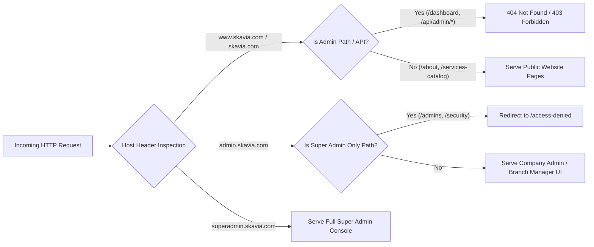

# SKAVIA — Web Ecosystem Architecture Specification
**Official Public Website & Web-Based Admin Portal**

---

## 1. Executive Summary & Core Principle

SKAVIA is an integrated, single-company on-demand services and skilled workforce platform operating across Bangladesh.

It is **NOT** a multi-tenant SaaS where external companies register and administer tenants. SKAVIA is a singular operational enterprise with eight internal trade specialization branches:
1. **HOME** — SKAVIA Home (Sanitary, plumbing, residential electrical, deep cleaning)
2. **TECH** — SKAVIA Technical (HVAC cooling, inverter diagnostics, CCTV, power distribution)
3. **AGRI** — SKAVIA Agriculture (Modern drip irrigation, pump automation, greenhouse maintenance)
4. **LOGI** — SKAVIA Logistics (Heavy equipment transport, delivery dispatch, trade supply chain)
5. **DIGI** — SKAVIA Digital (Structured Cat6 cabling, PoE IP cameras, WiFi mesh, POS terminals)
6. **BIZ** — SKAVIA Business (Turnkey commercial fit-outs, commercial renovations, facility SLAs)
7. **CONS** — SKAVIA Construction (Masonry, tiles, civil repairs, acoustic gypsum partitions)
8. **EVNT** — SKAVIA Events (Temporary staging, high-voltage sound/lighting grids, power backups)

The web ecosystem comprises two completely isolated surface applications:
1. **Official Public Website** (`www.skavia.com` / `skavia.com`): High-converting, brand-establishing, customer-facing portal designed to educate visitors, showcase trade capabilities, transparent BDT pricing, service lifecycle, specialist revenue charter, and drive app downloads.
2. **Web-Based Admin Portal** (`admin.skavia.com` / `superadmin.skavia.com`): High-security, role-restricted operations portal for internal staff across three strictly audited roles: Super Admin, Company Admin, and Branch Manager.

---

## 2. Public Website Information Architecture

The public website contains **zero administrative UI, zero internal metrics, zero mock customer/worker portals, and zero multi-tenant registration interfaces**. External individual customers, business clients, and trade specialists interact exclusively via the official SKAVIA Android application or verified corporate contact channels.

### Routing Topology

| Route | Page Name | Primary Objective & Content |
| :--- | :--- | :--- |
| `/` | **Landing / Home** | Brand manifesto, live trade quick-select, 4-stage lifecycle summary, atomic escrow trust guarantee, Android APK direct download. |
| `/about` | **About SKAVIA** | Company mission, single-accountability model, 8 specialization branches overview, Dhaka HQ & operational governance. |
| `/services-catalog` | **Services Catalog** | Comprehensive trade listing across all 8 branches, upfront BDT price guidelines, turnaround SLAs, and trade filtering. |
| `/services-catalog/[slug]` | **Service Detail** | Deep-dive trade SOP, required tool inventory, material quality charter, diagnostic checklist, and direct app booking CTA. |
| `/branches/home` | **SKAVIA Home** | Specialization branch showcase for sanitary, plumbing, carpentry, and deep cleaning with safety protocols. |
| `/branches/technical` | **SKAVIA Technical** | Specialization branch showcase for inverter AC servicing, gas charging, DB board balancing, and security systems. |
| `/how-it-works` | **How It Works** | 4-stage service lifecycle: Natural Requirement Scoping &rarr; Specialist Dispatch &rarr; 4-Digit Arrival OTP Handshake &rarr; Escrow Release. |
| `/experience` | **Customer Experience** | Property protection charter, biometric NID verification, centralized dispute arbitration, digital invoicing. |
| `/specialists` | **Specialists Charter** | Specialist empowerment, 90% direct earnings charter, weekly bank/MFS settlements, branded safety gear, dignity code. |
| `/business` | **Enterprise Solutions** | Turnkey commercial fit-outs, preventive facility maintenance SLAs, multi-site retail POS rollouts, dedicated Team Leaders. |
| `/download` | **Download Hub** | Client-side hardware telemetry (ARM64 vs ARMv7), live APK checksum verification (SHA-256), step-by-step installation guide. |
| `/contact` | **Contact & Support** | Central operations dispatch desk, telephone hotlines, email routing, physical headquarters address, inquiry dispatch. |
| `/faq` | **Knowledge Base** | Categorized accordion FAQ covering OTP security, escrow guarantees, technician vetting, enterprise contracts, and support. |
| `/terms` & `/privacy` | **Legal & Privacy** | Platform terms of service, consumer safety guidelines, data protection, and escrow arbitration rules. |

---

## 3. Web-Based Admin Portal Architecture & 3-Role RBAC

The Web Admin Portal is engineered for internal SKAVIA personnel only. It strictly enforces Role-Based and Attribute-Based Access Control (RBAC/ABAC).

### The Three Internal Administrative Roles

### Role & Permission Matrix

| Capability / Module | Super Admin | Company Admin | Branch Manager |
| :--- | :---: | :---: | :---: |
| **All Branches Visibility** | ✅ Global | ✅ Global | ❌ Assigned Branch Only |
| **Branch Context Switching** | ✅ Allowed | ✅ Allowed | ❌ Strictly Locked |
| **Admin User Management (`/admins`)** | ✅ Full Access | ❌ Forbidden | ❌ Forbidden |
| **Security Audit Logs (`/security`)** | ✅ Full Access | ❌ Forbidden | ❌ Forbidden |
| **APK Release Signing (`/releases`)** | ✅ Full Access | ❌ Forbidden | ❌ Forbidden |
| **Service Creation & Editing (`/services`)** | ✅ Allowed | ✅ Allowed | ❌ View Only (Assigned) |
| **Worker KYC Verification (`/verifications`)** | ✅ Allowed | ✅ Allowed | ❌ Scoped Recommendation |
| **Dispute Arbitration (`/disputes`)** | ✅ Allowed | ✅ Allowed | ❌ Scoped View |
| **Payout Approval (Maker-Checker)** | ✅ Checker/Approver | ✅ Maker/Requester | ❌ Forbidden |
| **Bookings Dispatch (`/bookings`)** | ✅ Global | ✅ Global | ✅ Assigned Branch Only |
| **Workers Management (`/workers`)** | ✅ Global | ✅ Global | ✅ Assigned Branch Only |
| **Team Assembly (`/teams`)** | ✅ Global | ✅ Global | ✅ Assigned Branch Only |

### Branch Scoping & Strict Context Enforcement

When a Branch Manager logs in:
1. `session.branchScoped` is set to `true`.
2. The TopBar disables the branch selection dropdown and renders a persistent amber pill: `Branch Scope: SKAVIA <Branch Name>`.
3. Server-side API middleware (`resolveAuthorizedBranchFilter`) automatically injects `eq('branch_id', session.assignedBranches[0].branch_id)`.
4. Any attempt by a Branch Manager to query or mutate a booking, worker, or service from another branch returns `403 FORBIDDEN (BRANCH_MISMATCH)`.

---

## 4. Maker-Checker Financial Dual Control

To prevent unauthorized disbursement of funds, SKAVIA implements cryptographic Maker-Checker dual control on all payouts exceeding BDT 10,000:
1. **Maker (Requester)**: A Company Admin initiates a payout batch or financial adjustment with an attached business justification.
2. **Checker (Approver)**: The Super Admin reviews the immutable request in `/finance`. The database trigger and application RBAC strictly prohibit the requester from approving their own request (`assertMakerCheckerSeparation`).
3. **Step-Up MFA**: The approving Super Admin must satisfy a WebAuthn Passkey (biometric/FIDO2) or TOTP step-up authentication challenge within the last 15 minutes before the cryptographic release transaction is committed.

---

## 5. Domain Surface Isolation & Security Architecture

The Next.js 15 Edge Middleware (`src/middleware.ts`) enforces strict perimeter isolation:

### Security Headers & Hardening

1. **Strict Content Security Policy (CSP)**:
   - Restricts script execution to approved hashes and verified CDNs.
   - Forbids `unsafe-eval` in production runtime.
   - Enforces `frame-ancestors 'none'` to eliminate clickjacking attacks.
2. **HTTP-Only, Secure, SameSite=Lax Session Cookies**:
   - `skavia_admin_session` cookie cannot be read by browser JavaScript (`document.cookie`), preventing XSS token harvesting.
3. **Audit Logging & Incident Monitoring**:
   - Every administrative login, step-up MFA verification, permission change, and status transition is recorded in the `audit_logs` table with client IP, user agent, and timestamp.

---

## 6. Bilingual Localization Architecture

SKAVIA serves the domestic Bangladesh market with 100% bilingual parity between English and Bengali (বাংলা):
- **Dynamic Localization Context (`LanguageContext.tsx`)**: Reactive client provider persisting user preference in `localStorage` with smooth zero-reload switching.
- **Digit Conversion Engine (`formatters.ts`)**: Automatic conversion of Western Arabic numerals (`0-9`) to Eastern Bengali digits (`০-৯`) in timestamps, phone numbers, prices, and OTP handshakes.
- **BDT Currency Formatter (`formatBdtLocale`)**: Accurate formatting of Bangladeshi Taka (`৳২,৫০০.৫০` vs `BDT 2,500.50`).
- **Strict Parity Test Harness (`portals-localization.test.ts`)**: Vitest suite guaranteeing that every translation key present in English exists in Bengali with non-empty translated content.

---

## 7. Mobile Application Compatibility Contract

The existing SKAVIA Flutter mobile application (`lib/`) shares the Supabase PostgreSQL database. 

**Strict Compatibility Guarantee**:
1. **Zero Schema Collisions**: All database columns, stored procedures (RPCs), and tables utilized by the Flutter mobile client (`bookings`, `users`, `worker_profiles`, `categories`, `services`, `reviews`) remain backward-compatible.
2. **Independent Auth**: The mobile app uses Firebase Phone SMS OTP and Google Auth. The Web Admin Portal authenticates administrators via Firebase custom tokens, session cookies, and WebAuthn Passkeys.
3. **Decoupled Deployment**: The public website and admin portal build and deploy via Next.js 15 Vercel/Node containers independently of Flutter CI/CD pipelines.

---

## 8. Vercel-Inspired Design System Specification

The SKAVIA web ecosystem follows a unified design language inspired by Vercel's visual discipline and technical craft, adapted specifically to SKAVIA's physical service operations:

1. **Sub-Pixel Surface & Border System**:
   - Dark Mode: Pure obsidian-black background (`#000000` / `#070A11`), surface cards (`#0A0A0A` / `#0E1424`), with 1px sub-pixel borders (`rgba(255, 255, 255, 0.08)` to `0.12`).
   - Light Mode: Clean white background (`#FFFFFF` / `#F8FAFC`), crisp elevated cards (`#FFFFFF`), with subtle 1px dividers (`rgba(0, 0, 0, 0.08)`).
   - Card Highlights: 1px top highlight beam (`before:absolute before:inset-x-0 before:top-0 before:h-px before:bg-gradient-to-r before:from-transparent before:via-white/20 before:to-transparent`).

2. **Contrast & Typography System**:
   - Primary Headings: Plus Jakarta Sans with tight tracking (`tracking-tight`), high visual weight.
   - Body Copy: Inter with calibrated line height (`leading-relaxed`) and WCAG AAA contrast (>= 7:1 against card surfaces).
   - Micro-Labels & Badges: JetBrains Mono uppercase labels (`tracking-wider text-[11px] font-mono`) for trade codes, status indicators, and SLA metrics.
   - Tabular Numerals: Tabular number formatting (`tabular-nums`) for currency amounts, phone numbers, and time estimates.

3. **High-Contrast Interaction Buttons**:
   - Primary Call-to-Action: Vercel-style high-contrast pill button (solid black on white in light mode; solid white on black in dark mode) with subtle hover scale (`scale-[1.02]`).
   - Secondary Actions: Frosted sub-pixel bordered buttons (`backdrop-blur-md`) with subtle border brightening on hover.

4. **Segmented 3-Way Theme Switcher**:
   - `VercelThemeToggle`: Dedicated segmented radio pill rendering `System`, `Light`, and `Dark` modes with laptop, sun, and moon icons across both header and footer.

5. **Atmospheric Lighting & Grid**:
   - `HeroAtmosphere`: Multi-layer radial spotlight falloff with zero color banding.
   - Precision Dot Grid: SVG circular dot grid with organic radial mask (`maskImage: 'radial-gradient(ellipse 70% 55% at 50% 25%, black 20%, transparent 80%)'`).

---

## 9. REA (Reverse Engineer Anything) Investigation Log

Reverse engineering of benchmark platforms was executed using the official REA MCP server tools:

1. **REA Tool Utilized**: `capture_browser_scenario` launched via Chromium 157.0 with loopback CDP and accessibility tree extraction.
2. **Targets Investigated**:
   - `https://vercel.com/`: Reverse-engineered sticky backdrop navigation, dual-theme token structure, segmented theme switcher, and bento-grid card composition.
   - `http://localhost:3000/`: Verified reconstructed SKAVIA homepage accessibility tree, DOM hierarchy, and interactive scoping engine.
   - `http://localhost:3000/services-catalog`: Verified 8-branch trade directory rendering, filter pills, and transparent BDT pricing cards.
3. **Evidence Records Preserved**:
   - Vercel Homepage Baseline: `ev_2731898c5d5eaec68de70f2fd8994696af0b78900e4772fe264b789b7aafe679`
   - SKAVIA Live Homepage: `ev_e87d81037ac016888c745387eba9366aedb6e5a5935dd8ba3b42cf65bc57972a`
   - SKAVIA Live Services Catalog: `ev_4b1139c8fa27f0a59d7ffc1a7e972c1f5a8d830539cb036e2c076201078f888c`

---

## 10. Technical Verification & Build Metrics

| Verification Gate | Command Executed | Result |
| :--- | :--- | :--- |
| **TypeScript Typecheck** | `npm run typecheck` (`tsc --noEmit`) | **0 Errors** (Clean pass) |
| **ESLint Static Analysis** | `npm run lint` (`eslint . --max-warnings=0`) | **0 Warnings / 0 Errors** |
| **Vitest Test Suite** | `npm test` (`vitest run`) | **9 Files Passed, 43 Tests Passed** |
| **Production Build** | `npm run build` (`next build`) | **71 Static/Dynamic Pages Generated** |
| **Live REA Browser Run** | `capture_browser_scenario` | **100% Hydrated & Verified Accessible** |

